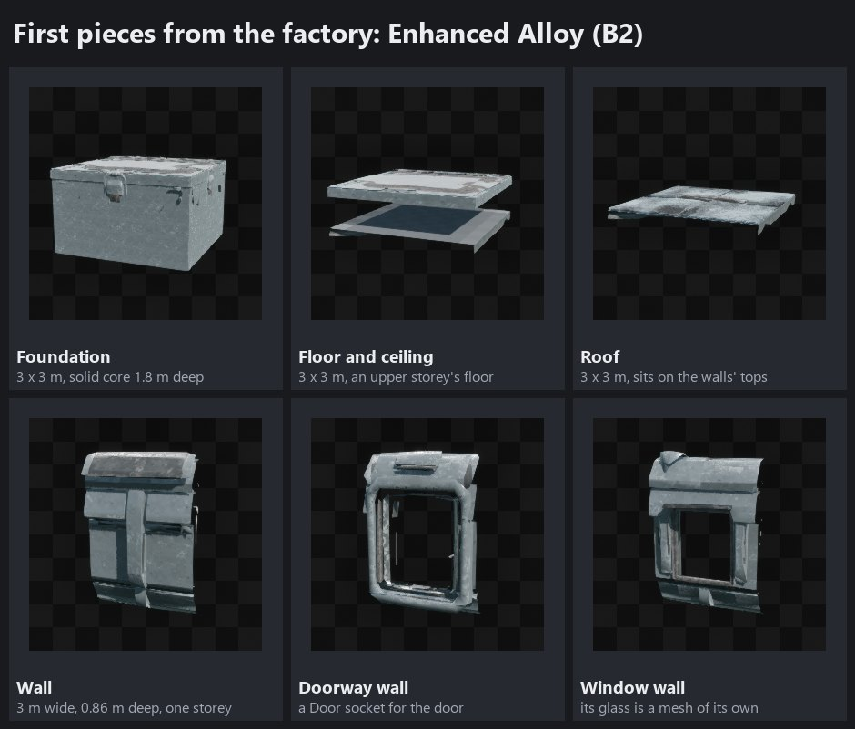
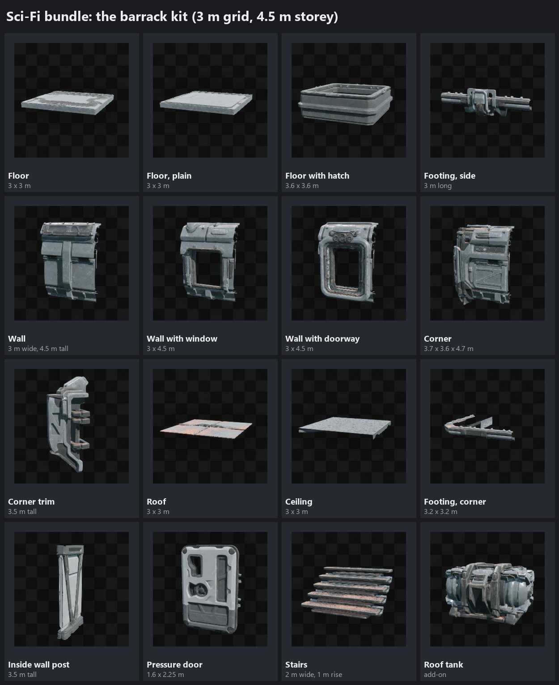
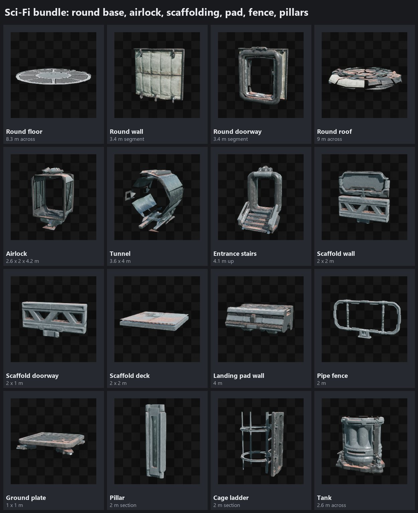
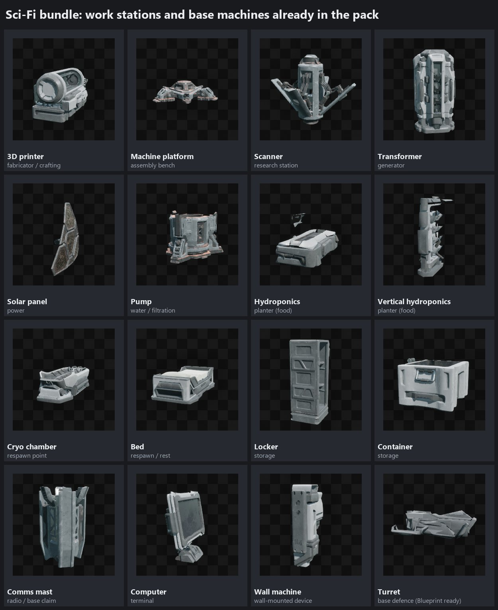
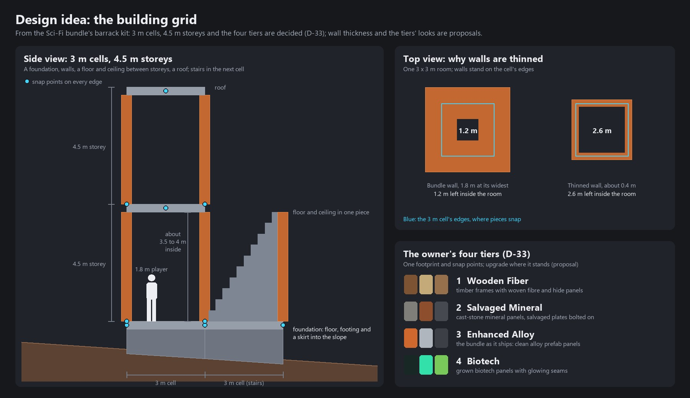
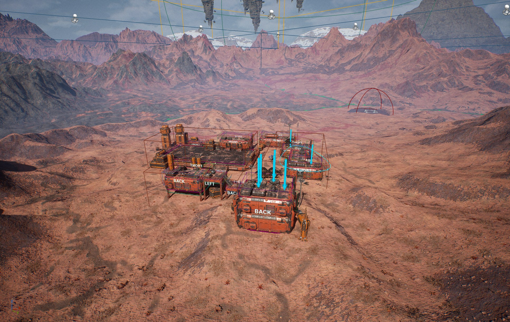
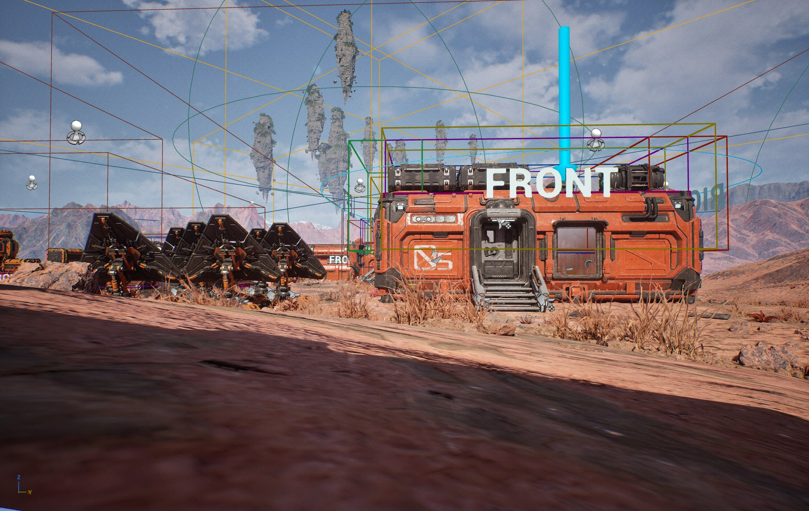

# Tharrn — Base building

The owner opened a **Building chat** on 2026-10-19: "Here we will access all the Bundles assests, like the floors,
barrack's ect. Here we will find what AI we need to connect to for rebuilding these assets for the survival aspect of
games : building bases, work stations, ect. we will rebuild the assests to be individual parts so a player can build as
they'd like so remodeling will need to happen. we will also have different tiers of building." (D-30)

This page is that chat's home: what the Sci-Fi Complete Bundle gives, what has to be remodelled, which AI and tools do
which job, the tiers, the work stations and the steps. A new chat on this work reads this page,
[GDD 03](gdd/03-survival-and-building.md) and the [bundle reference](scifi-bundle.md).

## 1. What the bundle has (measured 2026-10-19)

Read from the open editor through Unreal MCP without changing anything: every structure piece's size, triangles,
materials and Nanite setting, and a picture of each (section 10).

| Kit (under `/Game/ScifiOutpost/Models/Structure/`) | Pieces | Sizes | For player building |
|---|---|---|---|
| Barrack (`Buildings/Barrack`) | Floors (plain, with a hatch), footings (side, corner), walls (plain, window, doorway), corners and corner trims, roofs, ceilings, an inside wall post | 3 × 3 m cells; walls 3 m wide and 4.5 m tall; the floor sits 0.8 m up on its footing | The main kit: foundations, floors, walls, roofs |
| Round base (`Buildings/CirBase`) | Round floor, footing and roof; wall, window and doorway segments | 8.3 m across; segments 3.4 m wide and 3.4 m tall | One large round hall |
| Airlock (`Buildings/Airlock`) | Square and round connectors, a tunnel, entrance stairs | 2.6 to 3.6 m wide, about 4.2 m tall | Corridors between buildings, raised entrances |
| Scaffolding (`Buildings/Scaffolding`) | Base unit, decks, walls, a doorway, footings | 2 m grid | Walkways, catwalks, lookouts |
| Landing pad (`Buildings/LandingPad`) | Base unit, walls, roof | 4 m grid | A vehicle pad |
| Platforms, fences | Ground plates, pipe fences | 1 × 1 m plates, 2 m fences | Paths, railings, fences |
| Doors, stairs, pillars | A pressure door with its lever and glass; stairs in 1 m steps; pillars, cage ladders and tanks in 2 m sections | Door 1.6 × 2.25 m; stairs 2 m wide and 1 m up a piece | Doors, stairs, ladders, supports |
| Furniture and machines | 80 furniture meshes (and 29 screens, 14 lights), 22 machine meshes | — | Work stations, power, storage, beds (section 6) |
| Interactive objects and turrets (`/Game/ScifiOutpost/Blueprints`, `Turrets`) | 70 Blueprints of doors, lights, machines, furniture and containers; 28 pickable items; turrets with turret and ammo data | — | Section 6 |

**How the bundle uses them.** `BP_P_BuildingRegular` and `BP_P_BuildingCircular` (children of `BP_P_Building`) build a
whole building from a few numbers (floors, width, length and a seed), drawn as instanced meshes. The pieces were made
for that: "Structure meshes must share the same width and height, with the pivot at the bottom-left corner", and the
wall's size sets the size of a building's cell (main guide). Doors go on `Door_` sockets, scattered details on `S_`
sockets. The generator stays for the world's hubs and outposts ([bundle reference](scifi-bundle.md)); players get the
pieces one at a time.

**What shapes the remodel:**
- **`_D` meshes are mesh decals** (stripes, signs and grime laid over a piece; transparent, so without Nanite), and
  **`_W` meshes are window glass**. Neither is a damaged version. The structure pieces have Nanite on and 100 to
  15,000 triangles each.
- **One material for nearly everything.** "95% of the assets in this pack are using the same parent material,
  M_VP_Struct" (main guide). Wear comes from vertex colours (green: edges and damage; red: dirt in crevices), and each
  building's look from eight values (`F_CustomPrimitiveVisuals`): paint, metal, plastic, rubber and fabric colours,
  dirt, dust and damage. Inside and outside surfaces have their own material instances, so outsides can be dirtier.
- **The machines already have power and switch states** (`BP_P_LevelObject`): `IsPowerOn` (it gets power), `IsActive`
  (it is switched on), `IsInteractable` (a player may switch it); doors keep how far open they are (0 to 1); solar
  panels turn to the sun and pumps pump. Like the rest of the bundle's logic they are single player; Tharrn makes
  replicated versions (D-04, D-20).

## 2. What has to be remodelled

The barrack kit is already on a 3 m grid, the usual survival grid, but its pieces were made for the outside of one
generated building, not to stand alone:

| Today | For player building |
|---|---|
| A wall is 1.8 m deep at its widest (a 1 m slot behind its line plus its trims and top band), too thick between two 3 m rooms | A thinner wall (about 0.3 to 0.5 m, proposal) with the bundle's detail on both faces, centred on the cell's edge |
| The corner is an L-shaped wall that wraps a whole corner cell (3.7 × 3.6 m), placed at a building's four corners | A corner post that appears where two walls meet |
| Floors are slabs on separate footings | A foundation: the floor, footing on all four sides and a skirt reaching into the ground for slopes |
| No piece for upper floors | A floor and ceiling in one piece: the floor on top, the ceiling underneath |
| No triangles, half walls, ramps, gates or wall frames | Triangle foundation and floor and a half wall cut from the square pieces; a ramp, a gate and a wall frame for doors and windows |
| Stairs come in 1 m step pieces | Stairs for a whole storey (4.5 m) in one or two cells |
| Pivots at the bottom-left corner, no snap points, detailed collision | The pivot at the piece's centre, named snap points on every edge (`Snap_...`), simple box collision that matches the grid |

The bundle's colour, dirt and damage controls stay, so every remodelled piece still matches the bundle's outposts.

## 3. Which AI, and what does what

**Short answer: nothing new needs connecting to start.** The remodel is exact cutting and joining, which Claude does
itself through the editor. AI generation helps later, with art the bundle does not have.

| Job | Tool | Connected now? | Cost |
|---|---|---|---|
| Cut, join and re-pivot the bundle's pieces; snap points, collision, Nanite; each tier's colour, dirt and damage preset | Claude in the Unreal editor: Geometry Script from editor Python (its plugin is loaded in Tharrn's editor), run in a second editor in the background so the open one is not disturbed; Unreal MCP for checks and pictures | Yes | Free |
| New shapes the bundle lacks (triangle pieces, ramps, scrap plates); cleaning up generated meshes | Claude scripting Blender 4.1 (installed), or Unreal's modelling tools | Yes | Free |
| Concept pictures of each tier's look; build-menu icons | Higgsfield's image models | Yes: free plan, 10 credits | Credits |
| One-off props and new work stations from a picture | Higgsfield's 3D models: Meshy 7, Tripo H3.1 and P2, Hunyuan3D v3 (Meshy and Tripo can also make low-poly or quad meshes) | Yes, but 10 credits is one or two tries | 5 to 25 credits a model (Higgsfield's prices on 2026-10-19: Tripo 5, Hunyuan3D 3.1 Pro 16, Meshy 6 with PBR 25) |
| The same kinds of models through another account | fal.ai | No (no `FAL_KEY`) | — |

**Why the structure pieces are not generated by AI.** Image-to-3D models give one sculpted mesh with its own baked
textures. Its edges are not straight or exactly 3 m, so pieces would not line up or snap. It would not use the bundle's
material (its paint colours, dirt and damage), so it would look like another game next to the bundle's outposts. And
every change would be a new roll of the dice instead of a re-run of a script.

**Recommendation.** Start with the bundle and the editor (steps B2 to B4). Upgrade the Higgsfield plan only when new
art starts (the Wooden Fiber pieces, the Salvaged Mineral and Biotech detail, unique work stations, B5): first one piece through three 3D models side
by side (about 50 credits), then a plan sized to the one that wins.

**Licences.** Fab's library on this PC flags the listings whose publisher forbids use with AI (`is_ai_forbidden`). The
Sci-Fi Complete Bundle and the Hyper survival template are not flagged, so their listings allow using them with AI
tools, for example a picture of a piece as a reference. Western Desert Town is flagged; it is not used.

## 4. Tiers of building (D-33)

The owner named the four tiers after GDD 03's resources. How each looks and is made, and what it needs, are proposals:

| Tier | Look (proposal) | How it is made (proposal) | Needs (proposal) |
|---|---|---|---|
| 1 Wooden Fiber | The first shelter: timber frames with woven fibre and hide panels, lashed together | Its own simple pieces (frames and panels) on the same footprint and snap points; new art (B5) | Wood and organic fibre; from the start |
| 2 Salvaged Mineral | Rough mineral panels like cast stone, salvaged plates patched and bolted on | The bundle's shapes with a salvaged-mineral look (stone and rust colours, heavy dirt and damage) and bolted patches | Mineral and alloy scrap |
| 3 Enhanced Alloy | The bundle as it ships: clean alloy prefab panels in colony colours | The remodelled bundle pieces | Alloy; panels printed at the fabricator |
| 4 Biotech | Living technology: grown biotech panels with glowing seams | The bundle's shapes with biotech growth and glow (new detail, B5) | Biotech cores and a blueprint (GDD 04: higher tiers need blueprints) |

Rules (proposal): every tier keeps the same footprint and snap points, so a piece upgrades where it stands (hold the
build tool on it and pay for the next tier). A higher tier has more health and armour. On the bundle's shapes its damage
value rises as a piece loses health, so wear shows without extra models, and dirt and dust grow while a base decays
(GDD 03). Costs and health go in a CSV (D-07) when the system is built.

## 5. The pieces

The direction's modules (GDD 03: foundation, wall, door, turret, generator, filtration, crafting bench), the usual set
of survival games, and the pieces of the Hyper survival template's building system, from the bundle:

| Piece | Made from |
|---|---|
| Foundation, square and triangle | Barrack floor and footings |
| Floor and ceiling, square and triangle | Barrack floor and ceiling |
| Wall; half wall | Barrack wall, thinned; cut in half |
| Doorway and door; wide gate | Barrack doorway and pressure door; landing pad or airlock parts |
| Window wall | Barrack window wall and its glass |
| Wall frame (for a door or window to go in) | Barrack doorway, cut |
| Corner post; pillar | Barrack corner trim; medium pillar |
| Roof and roof edge (flat, the bundle's style) | Barrack roof and ceiling |
| Stairs, ramp, ladder | Bundle stairs; a new ramp; cage ladder |
| Railing, fence | Pipe fence |
| Walkway, catwalk | Scaffolding decks and walls |
| Corridor; round hall | Airlock connector and tunnel; round base |

## 6. Work stations and base machines

Most already exist in the bundle, many as interactive Blueprints with power states:

| Role (proposal) | Bundle piece | Blueprint |
|---|---|---|
| Fabricator (crafting; prints colony panels) | 3D printer | `BP_Printer` |
| Assembly bench (weapons, armour, fortified panels) | Machine platform and arm | — |
| Research station | Scanner | `BP_Scanner` |
| Generator | Transformer | `BP_Transformer` |
| Solar generator | Solar panel (turns to the sun) | `BP_SolarPanel` |
| Water pump and filtration | Pump (start, middle, end), tank | `BP_Pump` |
| Planters (food) | Hydroponics, flat and upright | `BP_HydrophonicHoriz1`, `BP_HydrophonicVer1` |
| Storage | Lockers, shelves, containers, cargo | `BP_Locker1`, `BP_Locker2`, `BP_Shelf1X`, `BP_Shelf2X`, `BP_ContainerBox1` to `3`, `BP_ContainerCargo1` and `2` |
| Respawn point and bed | Cryo chamber, bed | `BP_CryoChamber`, `BP_Bed` |
| Base claim and radio | Comms mast | `BP_Comms` |
| Terminal (tech tree, base menu) | Computers and wall screens | `BP_Computer_Desk1`, `BP_Computer_Wall1` and others |
| Lights (they use power) | Floor, wall, roof and portable lights | `BP_Light_*` |
| Defence | Turrets: machine gun, laser, missile launcher, with stands | `BP_Turret_*`, with turret and ammo data assets |

Each becomes a piece that snaps to floors or walls and uses Tharrn's own inventory, crafting and power (P4, P5).

## 7. The building system

GDD 03's build note stands: snapping, the ghost preview and the checks in C++ on the server; the power grid as a
server subsystem; decay as a slow server tick. Added here (proposal):

- A piece is data: `Data/BuildPieces.csv` lists each piece's meshes per tier, size, snap points, cost and health (D-07).
- Placed pieces are drawn as instanced meshes, one set per piece type and tier around each base: the bundle's own way
  of drawing many pieces cheaply.
- The build tool is a hotbar item (D-25); its menu lists the pieces you can build and what they cost.
- The Hyper survival template's building system (UE 5.5, Blueprints) is a reference for the piece list and how
  building feels, not code to bring in (D-33).

### The piece factory (B2)

`Data/BuildPieces.csv` (game repo) lists the pieces: their meshes, the size each should have and its snap sockets.
`Tools/Building/build_pieces.py` makes them from the bundle's barrack meshes in a background editor and checks them;
every run rebuilds every piece the same way (D-06). It cuts and joins with Unreal's Geometry Script, so the pieces keep
the bundle's materials, wear colours and UVs.

- **One frame for every piece:** z = 0 is the storey's floor, so every bundle mesh moves down 80.4 cm (the bundle's
  raised floor). Floors and foundations have their pivot at the cell's centre on the floor; a roof's pivot is where the
  next storey's floor would be, so it sits on the walls' tops; a wall's is the middle of its base line, its body
  centred on the cell's edge, the outside facing +Y.
- **Three meshes a piece:** the piece (Nanite), its decals (`_D`: stripes, signs and grime, see-through, so not Nanite)
  and, for windows, its glass (`_W`).
- **Sockets** (tag `TB`): floors and foundations have `Snap_Center`, four edges and four corners; walls `Snap_Base`,
  `Snap_Top` (4.5 m up), `Snap_Left` and `Snap_Right`; the doorway a `Door` socket for the door.
- **Collision:** simple boxes; the doorway's leave its opening free.
- **Remodel:** walls are trimmed where they reached into the room above the floor (the ledge, floor strips, skirting,
  the ceiling ledge with its lights); under the floor their base stays, hidden, and reaches 60 cm down so storeys
  overlap as in the bundle. A foundation is the barrack floor, a ring of footings and a solid core 1.8 m deep in the
  bundle's outside paint (the footings alone are an open frame you can see through).
- **Checks:** each piece's size against the CSV (walls measured above their floor), every socket, and that a wall's
  base reaches under the top of the wall below.

To look at in the gallery (B3): between storeys a 14 cm line can open on the outside between a wall's top band and
the wall above (the bundle's barracks are one storey high and its roof closes that line); a floor's sandwich (the
floor on top, the ceiling 1 m under it) is open at an edge with no wall, which wants an edge trim piece; walking
through the doorway's opening; how the trimmed walls' cut faces look from inside.

## 8. Working beside the map chat

Both chats use one editor, and an editor has one open level. So this chat only reads the open editor (sizes, pictures)
while the map work runs. Pieces are made in a second editor started in the background, which cannot take MCP's port
(harmless, engineering guide gotcha 4) and saves only under `/Game/Tharrn/Building`. Pieces are rebuilt only while no
open level uses them, and not while another chat compiles the game's C++ (a background editor holds the game's DLLs).
Once the open editor has drawn a piece (a thumbnail is enough) it keeps that Nanite mesh's file open, and a background
build can no longer replace it: build first, look at `TH_PREVIEW` copies, or wait for the editor's next restart. The
factory checks every file it saves, so this fails loudly instead of leaving an old piece.
Anything that needs its own level (the piece gallery, play-tests) waits for the owner's go while the map chat is idle.
The bundle's own folders are never saved (D-08).

## 9. Steps

| Step | What | Done when | State |
|---|---|---|---|
| B0 | The bundle's pieces measured and pictured; the remodel, the AI and tools, the tiers and the work stations proposed (this page) | The owner has read it | Done 2026-10-19 |
| B1 | The owner's choices: the tiers, the storey height, the Hyper template | Decisions logged | Done 2026-10-19 (D-33) |
| B2 | Piece factory: `Data/BuildPieces.csv` and `Tools/Building/build_pieces.py` (Geometry Script in a background editor) make every piece under `/Game/Tharrn/Building` from the bundle's meshes | Every piece rebuilds from the CSV with no problems; a test checks sizes and snap points | Done 2026-10-19: six pieces, RESULT ok (game repo `c509229`) |
| B3 | A gallery level with pictures from the game; the open points of the piece factory (section 7); the rest of the Enhanced Alloy set (the bundle's look): triangle foundation and floor, half wall, wall frame, door, corner post, edge trim, stairs, ramp | The owner approves the pictures | Next |
| B4 | The building system in C++: build tool, ghost preview, snapping, checks, placing, removing and upgrading on the server; instanced drawing | Tests; the network test with 2 clients and a late joiner; made-up placements refused | Later |
| B5 | Tier looks: the Wooden Fiber pieces; colour, dirt and damage presets and new detail for Salvaged Mineral and Biotech (Higgsfield or Blender) | Pictures of each tier; the owner's yes | Later |
| B6 | Work stations and base machines from the bundle (section 6), replicated | Each works for two clients | Later |
| B7 | Base rules (GDD 03): power grid, decay, claims, damage, saving the base | Tests; the network test | Later |
| B8 | A large base within the budget (D-11); the owner's play-test | 16.6 ms; the owner's yes | Later |

## 10. Pictures

The wiki's Building Assets tab shows these: the owner's and this chat's space for progress and design ideas (newest
first in each list).

### Progress

- 
- 
- 
- 

### Design ideas

- 
- 
- 
