# Deliverable 8 — HUD layout and icon pack

Version 0.1, 2026-10-15. The direction asks for the HUD JSON and a PNG icon pack (§5.6).

## Layout

The layout is the game's `Data/UI/HudLayout.json` (the owner's draft, corrected; [GDD 10](../gdd/10-ui-hud.md)):
compass top centre 800 × 48, minimap top right 240 × 240, vitals bottom left (health, stamina, hunger, hydration,
temperature, neural), weapon panel bottom centre 420 × 120, quick-use wheel bottom right with 4 slots, and a dynamic
crosshair in the centre with the variants default, precision and suppressed. Sizes are for 1920 × 1080 and scale
with resolution.

## Icons (placeholders)

Twelve line icons, white on a transparent background so the HUD can tint them (red for a PvP warning, amber for a
low vital). 256 × 256 PNG, with the SVG source beside each, made by `tools/build_hud_icons.mjs`. They are
**placeholders** for the Prototype HUD (P4 and P5) until the owner sets the art direction.

| Icon | File | Used for |
|---|---|---|
|  | `ammo` | Magazine and reserve count |
|  | `compass` | Compass bar |
|  | `crosshair` | Crosshair settings |
|  | `health` | Health bar |
|  | `hunger` | Hunger |
|  | `hydration` | Hydration |
|  | `minimap` | Minimap toggle |
|  | `neural` | Neural stability |
|  | `quickwheel` | Quick-use wheel |
|  | `stamina` | Stamina ring |
|  | `temperature` | Temperature gauge |
|  | `weapon` | Weapon panel |

(The icons are white: they show on a dark background.)

In Unreal they become textures `T_UI_<Name>` under `/Game/Art/UI/Icons/` (owner's naming, engineering guide §5),
imported as user-interface textures without mipmaps, when P4 and P5 build the HUD.
