# The main map: design and build plan (P6, version 2, 2026-10-19)

**Deleted on 2026-10-24 (D-45).** The owner had the main map removed for a redesign with a new direction; a new map follows later, and the test map stays. This page remains the record of version 2. What was removed, where it sits until the owner empties the trash folder, and what is kept: [§13](#13-next).

The main map `L_Main` is rebuilt from the Sci-Fi bundle's example level (D-34). The first version (D-27's island of
2.56 km zones at 2 m, built 2026-10-19 morning) is scrapped; its plan is in Git history (design record `03816b6`).

What the owner asked, 2026-10-19:

- "for L_Main i want that scrapped, use ExampleLevel_Bundled in a way that it makes a better version, use any means you
  need to make it 100sq km with better biome transitions ect. Can add more open plains in between if needed for
  smoother driving with the hover bike and Buggy. we are building a C++ game so the limits are endless. the north west
  area of the map will be the artic area. if we need to make the map larger due to the speed of the vehicles then lets
  do so. travel time from south to north should take an hour running and 35 min in the vehicles."
- Asked which should set the size (the two times need vehicles only 1.7 times as fast as running, the bundle's are far
  faster): "Big map for fast vehicles".
- "i want the newest modern warfare level of detail, use HLOD or nanite, whatever it takes to get the highest quality
  of map/landscape for players to enjoy. all the assets needed are in the files already. dont place the building
  structures."
- "world and zones, map build tabs for the wiki are yours to control, you will merge the tabs and put all your data and
  pictures there, you are in charge of that area. we can have a question section if needed and a To Do task list also."

The earlier owner request still holds: "AAA" quality and feel, with harvesting built in (trees cut down, rocks mined,
sticks and stones picked up, plants harvested for fibre and food), section 8.

## 1. Size and travel

| | Number | How |
|---|---|---|
| South to north | **45.9 km** of land (46.0 km box) | The vehicles decide (the owner's choice): 35 minutes at about 22 m/s (79 km/h) average. The bundle's hoverbike boosts to 35 m/s and the buggy to 55 m/s (their Blueprints' `MaxSpeedLimit`, against the forward speed in cm/s) |
| On foot | About 2.5 hours south to north | At the run speed of 5 m/s (D-19); the 1 hour asked for would need 12.7 m/s, so it is not kept: an open question (Q1) |
| West to east | 22.4 km at the widest | |
| Land | **714 km²** (D-26's 100 km² was for a 10 km map) | 6 × 12 landscape tiles of 4.06 km cover 24.4 × 48.8 km; tiles that are all deep sea are left out |

## 2. The bundle's example level, and what the new map takes from it

Measured 2026-10-19 (`ExampleLevel_Bundled`, exported with `ExportLandscape`):

| The example level | Measured | In the new map |
|---|---|---|
| Landscape | 4 × 4 km at **1 m**, Nanite on, the combined material, 10 paint layers, up to 7 in one component | **1 m everywhere** (6 × 12 tiles of 16 × 16 components), Nanite on, the same material; up to 6 layers a component |
| Relief | -18 to 309 m; steep eroded ground: half of it steeper than 26°, a third steeper than 35°; fine gullies at 1 m | Its eroded relief (high-passed at 350 m) is laid over every region in 2 km cells, each turned and mirrored its own way, as much as each region takes (all of it in the desert canyonlands and badlands, little on the plains) |
| Paint | Large single-layer patches (orange desert, grey moon, green jungle, white snow) with hard edges | Patches that interleave across about a kilometre at every region border (section 4) |
| Biome volumes | 36, each 670 m square, every one listing all nine presets (desert, desert grass, acid, moon, jungle, jungle swamp, arctic snow, shore, swamp), the paint choosing | One a kilometre square; each lists the presets painted in it, with Tharrn's shore and columnar presets too; each has its own lowest point (section 6) |
| World Partition | Its own streaming grids, default HLOD layer `HLODLayer_Instanced`, HLOD layers per kind (landscape, foliage, buildings) | Copied whole (`CopyWorldPartitionSettings`); landscape tiles on `HLOD_Landscape`, biome volumes on `HLOD_Foliage` |
| Sky | The environment controller with its sun, sky light, atmosphere, clouds, fog, post-process, two planets, a moon, the space sphere | Copied with every setting; Tharrn's clock drives it (P6.7) |
| Floating islands | 7 sets | Over the north-east lagoon (the Floating Archipelagos) |
| Distant mountains | 20 meshes round the edge, as a backdrop | Not needed: the sea is all round |
| Colonies (3 outposts) | Buildings, props, lights | **Not placed** (the owner) |

## 3. The layout

North is up; the regions get harder toward the north.

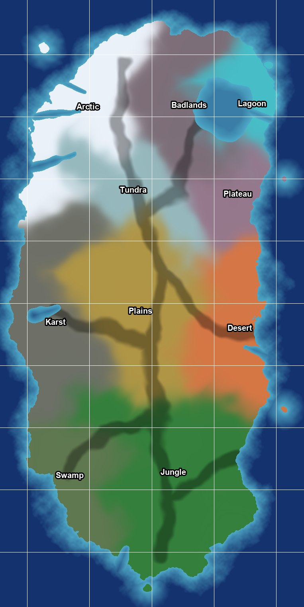

| Region | Where | Landforms | Ground (the bundle's layers) |
|---|---|---|---|
| Jungle (Fungal Forest) | The south | Rolling hills cut by river valleys, the example's relief at 42 % | Jungle; jungle swamp in wet valleys |
| Swamp (Coastal delta) | The south-west | A flat river delta, low islands | Jungle swamp; jungle on firmer ground |
| Coast | All round | Beaches; rocky coasts in the karst and the arctic | The shore layer of the region (jungle, desert or arctic shore) |
| Plains | The middle | Long low swells for driving, lone rocky hills (inselbergs) | Desert grass (red savanna); jungle along the rivers; moon rock on the hills |
| Desert (Crystalline Desert) | The middle east | Canyonland from the example's relief, dune seas in the low parts, a crater (Skitterjaw Hollow) | Desert sand; grey moon patches; desert grass where wetter; acid round the pools |
| Plateau (High-Gravity Plateau) | East of the north middle | A mesa 190 m above its surroundings, ragged edge, 11 canyons into it, stepped cliffs | Moon sand on top; columnar rock (Tharrn's preset) on the cliffs |
| Karst (Subterranean Caverns) | The west | Fluted rock towers in clusters, a few giants, sinkholes | Green floors (jungle), moon rock, columnar towers |
| Tundra | North of the plains | Broad rolls, kettle lakes | Arctic swamp (tundra); snow on north-facing slopes; moon rock on ridges |
| **Arctic** | **The north-west** (the owner) | A mountain range with peaks near 900 m, U-shaped valleys, three fjords | Snow; bare rock on cliffs; arctic swamp on low valley floors; arctic shore |
| Badlands | The north middle | Grey eroded hills, old craters | Moon sand with red desert patches, acid pools |
| Lagoon (Floating Archipelagos) | The north-east | A lagoon inside a ring of reef land, open to the east; floating islands above | Jungle, shore |

**Driving corridors:** six lines of gentle ground (relief cut to 15 %, no lakes) from the south coast to the north,
into the desert, the karst, the lagoon, the delta and the south-east coast, about 1.2 km wide. Besides them the plains,
the tundra, the dune seas' edges and the arctic's valley floors are open driving ground.

## 4. Biome transitions

The example level's biomes meet at hard edges. The new map blends them the way vegetation does:

- Every region has seed points; a point's regions are weighted by its distance to them through a warped space, so a
  border wanders and fades over about a kilometre.
- The paint picks one region at each point: each region's weight plus its own patch noise (420, 160, 48 and 14 m);
  the strongest wins. Across a border the patches of both regions interleave, thinning out with distance, from
  stands hundreds of metres across to single clumps.
- The land moves the paint further: gallery forest along rivers into the plains, swamp in wet hollows, acid round the
  desert's pools, beaches and river banks in the shore layer of the region around them, snow above a snowline that
  falls toward the north and lies lower on north-facing slopes, bare rock where it is too steep for snow.
- Heights blend over the same distance, so landforms change gradually too.
- Each point gets one layer (the presets need 0.9 or more to grow), softened over a metre or two for the material.

## 5. Technical set-up

| Part | Set-up |
|---|---|
| Level | `/Game/Tharrn/Maps/L_Main`, World Partition, the example level's streaming settings |
| Landscape | 6 × 12 tiles of 4,064 m (16 × 16 components of 254 quads, 2 × 2 sections of 127) at 1 m, one landscape each, edges shared exactly; Nanite on with a 50 cm skirt where tiles meet; streaming proxies of 2 × 2 components; on `HLOD_Landscape`; both runtime virtual textures (adaptive, about 5 cm a texel over the map) |
| Heights | -84 to about 900 m, one Z scale for every tile |
| Size on disk | About 1.15 GB a tile with its Nanite meshes (the example level's rate), so about 60 GB for the landscape; the saved rocks and trees about 100 MB a km² (the example level's rate) |
| Sea | One plane of the bundle's water, 75 km across (Unreal's ocean draws nothing at this size, gotcha 106) |
| Dressing | The bundle's biome volumes, a kilometre square, generated one at a time: rocks and trees saved with the level, bushes and debris at run time (Tharrn's network-safe copies, gotcha 95) |
| Streaming | World Partition cells and HLODs for landscape, foliage and the rest, built from the command line |
| Budget | 16.6 ms a frame at 1440p on the target tier (D-11) with DLSS; measured with the editor closed |

The editor builds and edits the map a tile at a time (all of it at once would need far more than the PC's 64 GB).

## 6. The terrain tool and the level builder

`Tools/World/main_map_terrain.py` (game repo):

1. **layout** (32 m): the coast (an outline, ragged by noise, three fjords, bays, islets, the lagoon), the regions'
   weights, the corridors.
2. **macro** (8 m, 3,049 × 6,097 points): each region's landforms, the example level's relief, the corridors cut
   gentle, the coast and seabed, raindrop and slope erosion, lakes where they belong (tundra kettles, arctic tarns,
   karst sinkholes, jungle lakes, the desert's acid pools), rivers and streams traced to the sea.
3. **tiles** (1 m): the macro heights refined with the example level's finer relief and rough ground, the rivers cut
   at 1 m, the paint (section 4); each tile's height and paint files, and its biome volumes with their presets and
   lowest points. The lowest point is the local valley floor: the presets thin their plants and grow their rocks with
   height above it (jungle trees thin to 10 % at 100 m above it, desert cliffs and mesas grow up to three times larger
   toward 160 to 200 m).

`Tools/World/build_main_map.py`: **scrap** (the old level and its leftover files), **level** (World Partition settings,
sky, clock, sea, virtual textures), **landscape** (the tiles, one at a time), **water** (river splines, lakes),
**dress** (the biome volumes), **pictures**.

New editor tools in C++ (`TharrnWorldBuildToolset`, tested in `Tharrn.Editor.WorldBuild`): `ExportLandscape`,
`SetLandscapeNanite`, `BuildLandscapeNanite`, `DeleteLandscape`, `CopyWorldPartitionSettings`, and an HLOD layer on
`CreateLandscape`.

## 7. Places

Each region gets its places as the zone notes say, without buildings for now (the owner): the starting crash sites
(D-28) as wreckage, ruins as rock formations, the dungeon mouth in the karst. The 15 zones and the 8 starting locations
are laid out again on the new map (to do: their data is still D-27's).

## 8. Harvesting (built into the map from the start)

| What | Where | Gives | Tool |
|---|---|---|---|
| Trees: cut down | Jungle, swamp, the plains' gallery forest, desert palms | Wood (and sap, fibre from some) | Hatchet (more with better tools) |
| Rocks: mined | Boulders and outcrops everywhere; ore and crystal rocks in the desert, badlands and on the plateau | Stone; metal ore; crystals | Pickaxe |
| Sticks and stones: picked up | On the ground in every region, most near the starts | Sticks, stones | Hands |
| Plants: harvested | Bushes, ferns, fungi, grasses; arctic shrubs | Fibre; food (berries, fungi, roots) | Hands (a knife gives more) |

How it works (C++, server-authoritative): the trees and rocks the bundle places are instances in the saved PCG cells;
plants and debris come from the run-time layer. A harvest system knows which meshes are which resource (a data
table), takes hits from tools or a use key, and on the server counts each thing down; when one is used up it hides it
on every machine (and for anyone joining later: the server keeps the list, keyed by a stable id from its place and
mesh), drops the items, and grows it back after a while. Trees fall over before they go. Tools, items and recipes go
into the game's data files (`Items.csv`, `Recipes.csv`).

## 9. Progress

| Step | What | State |
|---|---|---|
| M1 | Plan; the example level measured and exported; the size settled with the owner | Done 2026-10-19 (this page) |
| M2 | Terrain tool v3 (`main_map_terrain.py`): layout, macro, tiles | Done 2026-10-20: 68 tiles at 1 m (heights -94 to 649 m), every shared edge exact, 0 components over the layer limit, 790 biome volumes with their presets and lowest points |
| M3 | `L_Main` v2: the level, the 1 m landscape tiles, the sea, rivers and lakes | Done 2026-10-21: all 68 tiles in by 00:05 (0_0, 3_7 and 4_7 whole; the other 65 as 260 quarters of 2 km, D-43), Nanite on, about 3 hours unattended, each quarter about a minute with about 20 GB of memory left free; the rivers and lakes at 00:07 (126 river and stream splines with 20 falls, 257 lakes and pools; the bundle's river Blueprints also make about 12,900 empty PCG partition actors along them). The level made 2026-10-19 (the example's World Partition settings and sky, the clock, the sea as 16 planes, the virtual textures) |
| M4 | Dressing with the bundle's biome presets; floating islands; HLODs | Stopped for good at 135 of 790 on 2026-10-24, the map deleted (D-45); was 126 of 790 biome volumes by 2026-10-21 15:51 (the arctic north-west and the west coast's jungle), about 7.5 minutes each (5 to 11), one editor crash in the PCG plugin on the way (14:58; only the volume in hand lost). The 8 floating island sets are placed but empty: the bundle's floating graph gets no input in this level (to look at) |
| M5 | Harvesting | Later |
| M6 | Places (crash sites, ruins, the dungeon mouth, zones and starts laid out again) | Later |
| M7 | Look: per-region fog and light, sound beds | Later |
| M8 | Budget and checks | Later |

## 10. Questions for the owner

| # | Question | Proposal |
|---|---|---|
| Q1 (OQ-23) | On foot the 45 km take about 2.5 hours, not the hour asked for (running is 5 m/s; an hour would need 12.7 m/s). Keep it, or make running faster, or add fast travel? | Keep running as it is; travel on foot is for exploring, vehicles for crossing; fast travel between discovered outposts later |
| Q2 (OQ-24) | The 15 zones of D-27 were 2.56 km squares. On the new map each would be about 50 km². Keep 15 big zones, or more zones? | Keep the 15 zones and their levels, redrawn to follow the regions (a zone is a region's part); propose a picture before changing the data |
| Q3 (OQ-29) | The vehicles' speeds: tune them so the crossing is 35 minutes on the corridors? | Measure the hoverbike and buggy on the corridors once the map is built, then set their top speeds |
| Q4 (OQ-33) | The first dressed tile (3_7): the amount of trees, grass and rocks, and the jungle–savanna edges. Right as they are? | Keep them for the rest of the island |
| Q5 (OQ-40) | The biome volumes take about 7.5 minutes each (744 left: about 4 days of the editor). Let them run, with gaps for the other chats? | Yes, with gaps through the Master chat; meanwhile I look for the cause (the editor uses one core of 24). The owner, 2026-10-21: run until 16:00 today |

## 11. To do

- [x] Measure the example level; export its terrain (1 m heights, 10 paint layers)
- [x] Editor tools: landscape export, Nanite with skirts, Nanite build, landscape delete, World Partition settings copy, HLOD layer on new landscapes; their tests
- [x] Terrain tool v3: layout
- [x] Terrain tool v3: macro heights, erosion, water (rivers as smooth meandering curves)
- [x] Terrain tool v3: the 1 m tiles and their paint (68 tiles, edges exact)
- [x] Scrap the old `L_Main` (the level, its HLOD layers and 4,455 actor files)
- [x] Build the new level
- [x] The tiles: all 68 in (2026-10-21; 65 of them as 260 quarters)
- [x] Rivers and lakes (2026-10-21)
- [x] Dress one tile first (16 biome volumes, about 2 minutes each; pictures above)
- [ ] Dress the rest (about 900 volumes: a day of the editor, unattended)
- [ ] Floating islands over the lagoon: placed 2026-10-21; their graph makes nothing here yet (a Blueprint step in `PCG_Jungle_Floating` gets no input), to compare with the example level's own sets. Lead (read from the graph file): it finds its places with "Get Volume Data" and "Get Actor Data" (actors chosen by class or tag across the world) and "Find Locations and Exclude Excluders" (the `PCG_S_Excluder` subgraph, which reads splines). The example level probably has the actors or volumes it looks for, and L_Main doesn't
- [ ] HLODs; the budget measured with the editor closed
- [ ] Zones and starting locations laid out again (Q2), the zone data and tests
- [ ] Harvesting (M5)
- [ ] The wiki's world and map tab: merged, with these questions and this list

## 12. Pictures

- 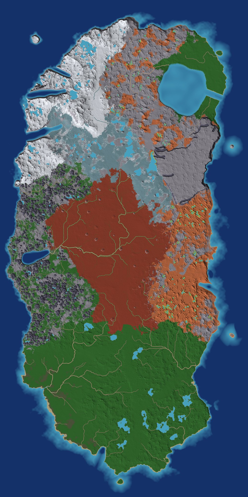
- 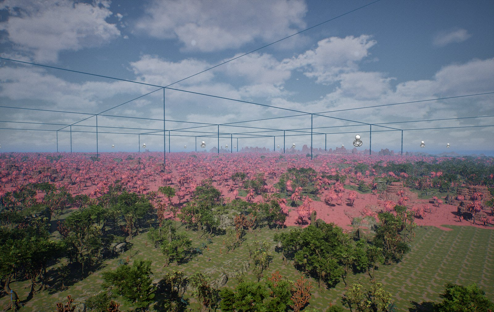
- 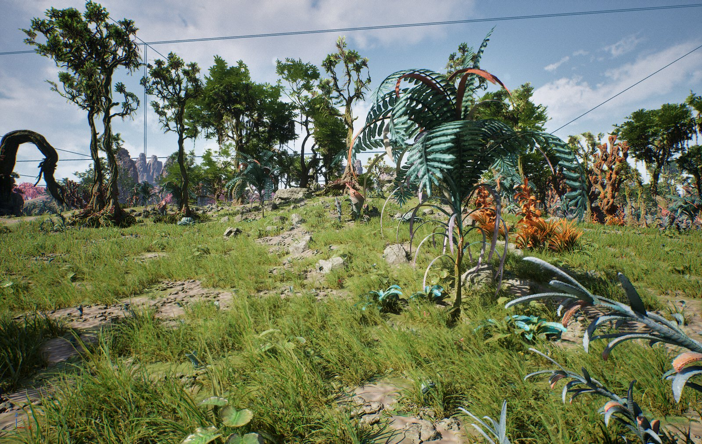
- 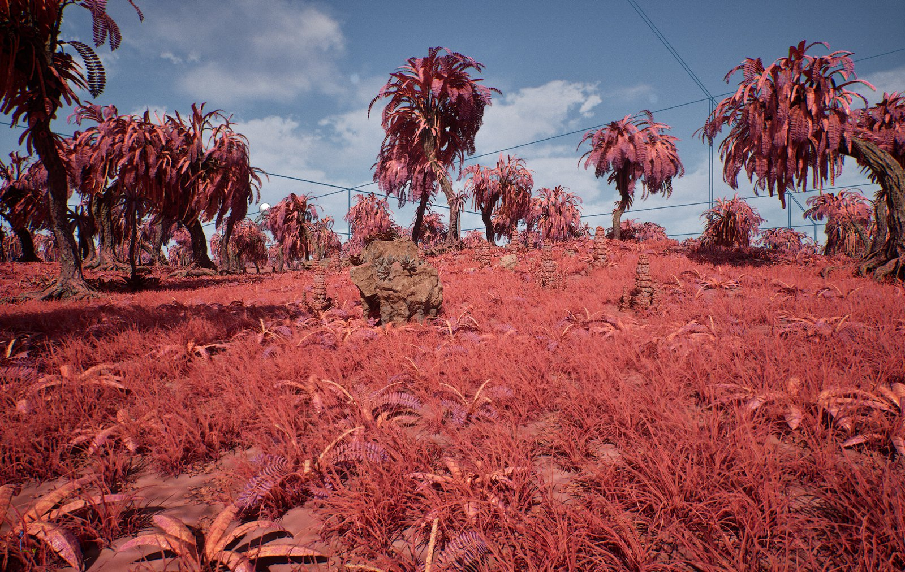
- 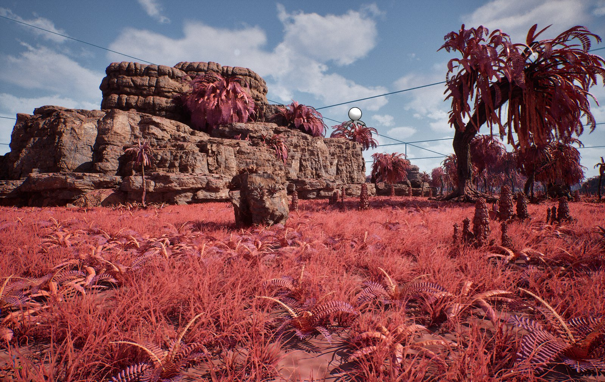
- 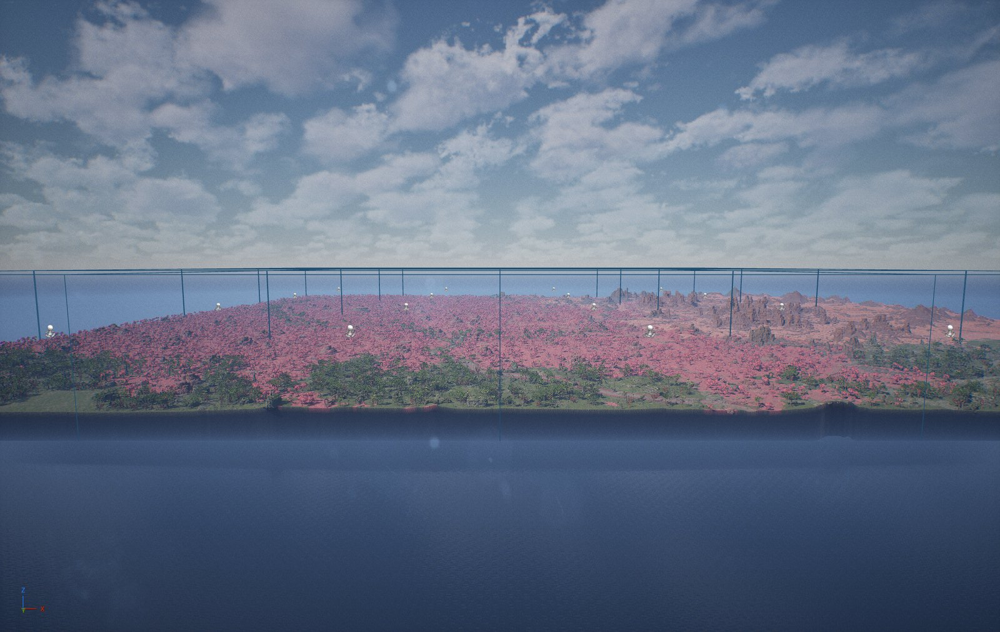
- 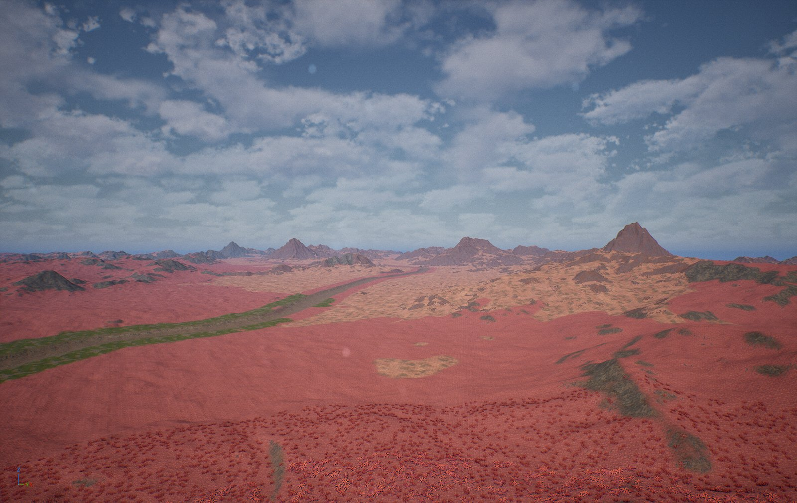
- 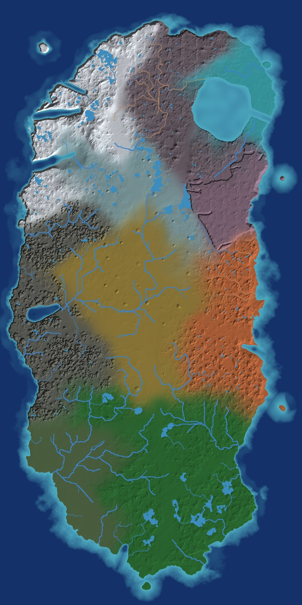
- 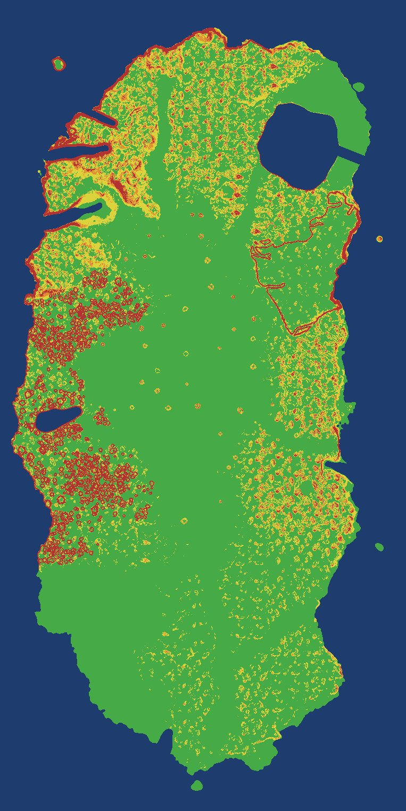
- 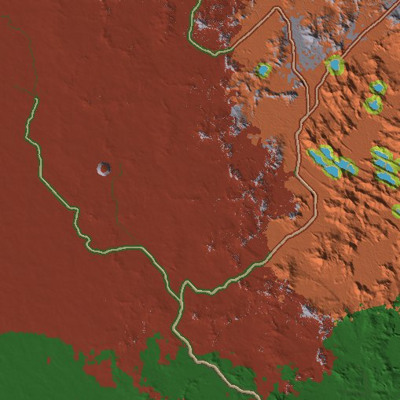
- 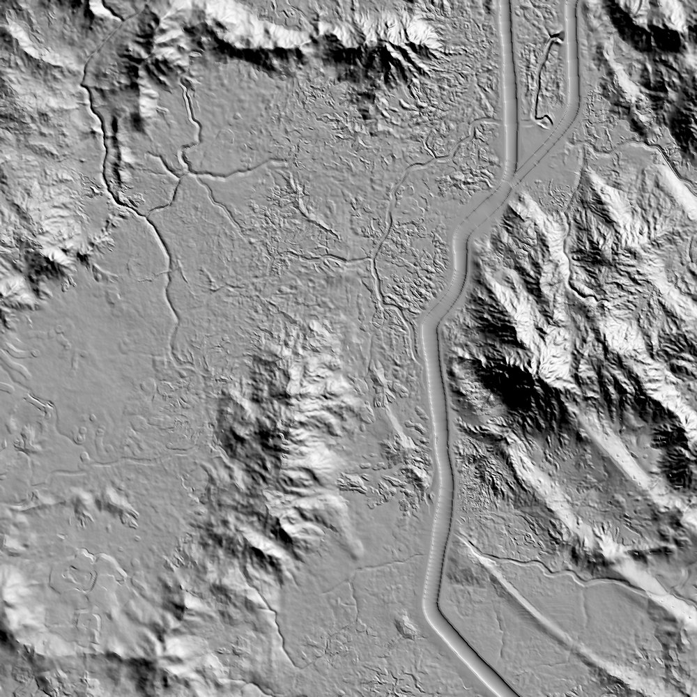
- 
- 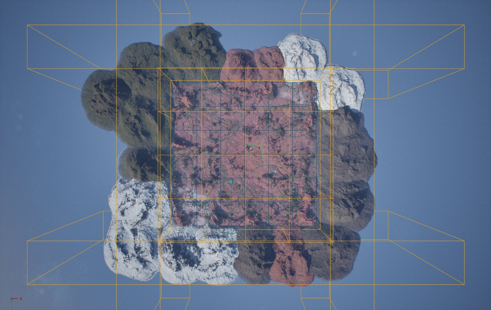
- 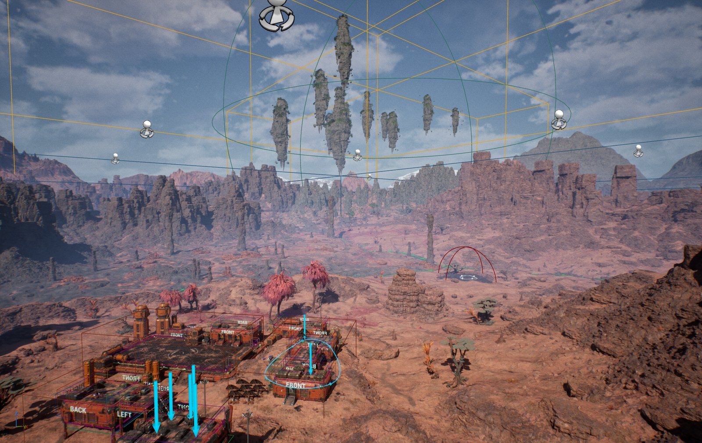
- 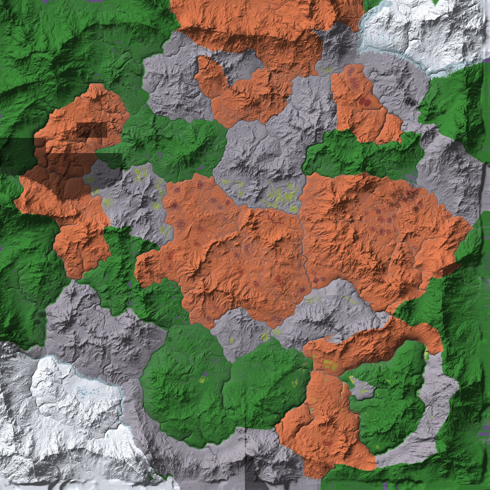

## 13. Next

**The main map was deleted on 2026-10-24 (D-45).** The owner's word, to the Master chat: "the entire map needs to be
deleted, new map to follow later on, we are going to do a redesign and new design of workspace wiki ect with a better
direction", "we can keep the test map"; to the Map chat, on the list below: "delete them all except the test map". The
dressing stopped for good at 135 of 790 volumes (OQ-40 void).

Claude Code's permission check refused the delete itself (an irreversible loss of 79 GB), so with the editor closed the
Map chat **moved** everything out of the project into `D:\Tharrn_trash_2026-10-24_main_map`, 79 GB in 23,039 files,
with the folder structure kept; **the owner emptied that folder at 14:37 the same day, so the 79 GB are gone for good.** Tharrn no longer has the map: `Content/Tharrn/Maps` holds `L_TestRange` and
`L_TharrnMainMenu` only, and `.gitignore` lost its four `L_Main` rules.

| Deleted | Size | In Git |
|---|---|---|
| `Content/Tharrn/Maps/L_Main.umap`, `L_Main_HLODLayer_Instanced`, `L_Main_HLODLayer_Merged` | 18 KB | no |
| `Content/__ExternalActors__/Tharrn/Maps/L_Main/` (68 tiles, 260 quarters, water, 135 dressed volumes with their PCG output, floating sets) | 62 GB, 20,773 files | no |
| `Saved/Terrain/` whole: `main` (15 GB: tiles and quarters, `volumes.json`, `dressed.txt`), `tiles`, `island`, `island_blockout`, `example`, `coast_test`, the `cand_*` lidar candidates, the overview pictures | 18 GB | no |
| `L_CoastTest` (the level, its HLOD layers, 86 external actors, the external objects) | 71 MB | yes: 92 files show as deleted |
| `Saved/ClaudeScratch/map_*.log` | 98 KB | no |

**Done, 1: the trash folder is emptied** (owner, 2026-10-24 14:37, `! rm -rf /d/Tharrn_trash_2026-10-24_main_map`).
`L_CoastTest` is the only part that can still come back, from Git.

**Needs the owner, 2: the commit in `D:\Tharrn`** that records `L_CoastTest`'s removal and the `.gitignore` change (92
tracked files deleted, nothing committed yet). `L_CoastTest` went on "them all"; the other Map session had recommended
keeping it, because `Tools/Checks/nature_test.py` and a WorldBuild toolset test (`TharrnWorldBuildToolsetSpec.cpp:414`)
open it. If it should stay: `git checkout -- Content/Tharrn/Maps/L_CoastTest* Content/__ExternalActors__/Tharrn/Maps/L_CoastTest Content/__ExternalObjects__/Tharrn/Maps/L_CoastTest`,
and `Saved/Terrain/coast_test` comes back from the trash folder (or `Tools/Terrain/test_coast.py` makes it again).

**Kept:** `L_TestRange`, `L_TharrnMainMenu`, the `Tools/World` scripts (`main_map_terrain.py`, `build_main_map.py` and
the rest), the WorldBuild toolset and `/Game/ScifiOutpost_Tharrn/PCG` (the biome blueprints and the runtime graph made
for the bundle's presets). The Sci-Fi bundle's own example level is untouched. `TharrnProgressionLibrary.cpp:142` still
names `L_Main` until the new map comes; `Tools/UI/make_planet_textures.py` cannot run again (the planet textures it made
stay).

**Follow-ups for the next build round** (so nothing surprises it): `TharrnProgressionLibrary.cpp:142` still names
`L_Main`; the WorldBuild toolset test that calls `CopyWorldPartitionSettingsIn` on `/Game/Tharrn/Maps/L_CoastTest`
(`TharrnWorldBuildToolsetSpec.cpp:414`) now fails, and `Tools/Checks/nature_test.py` opens that level: either restore
`L_CoastTest` from Git (the one checkout above) or point both at `L_TestRange` or the new map. The owner confirmed the
four parts in the other Map session as well ("Delete all four").

**Next for this page:** nothing until the owner's redesign gives the new map's direction. §1 to §12 stay as the record of
version 2 (D-34); the new map gets a plan of its own.
