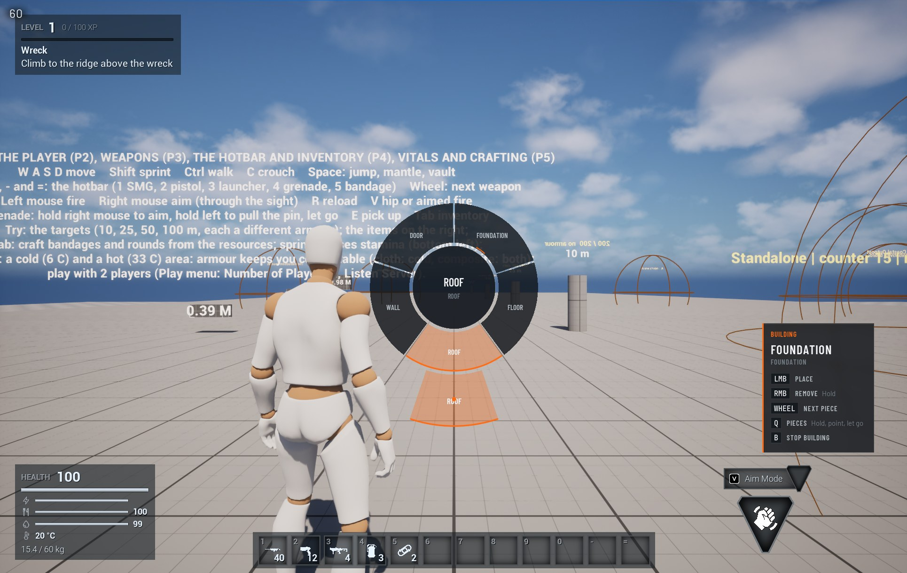
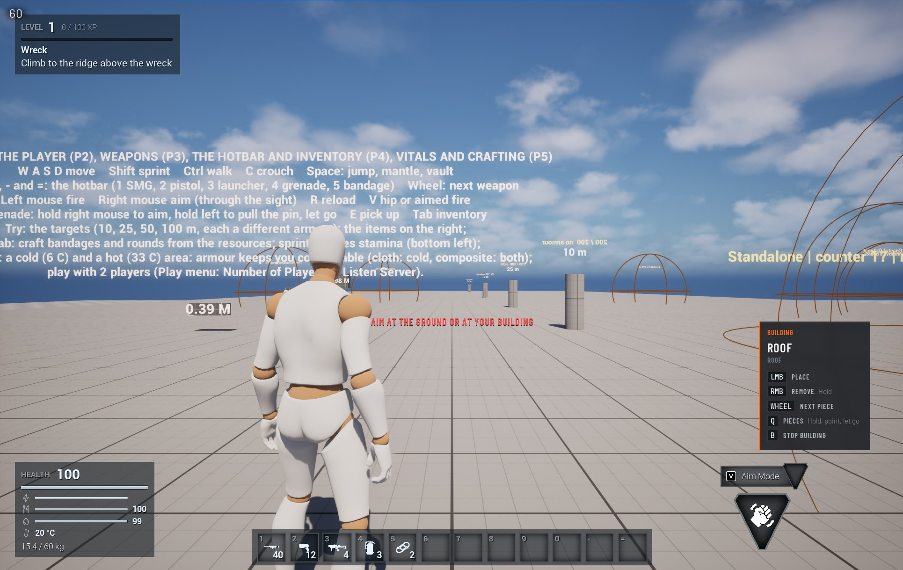
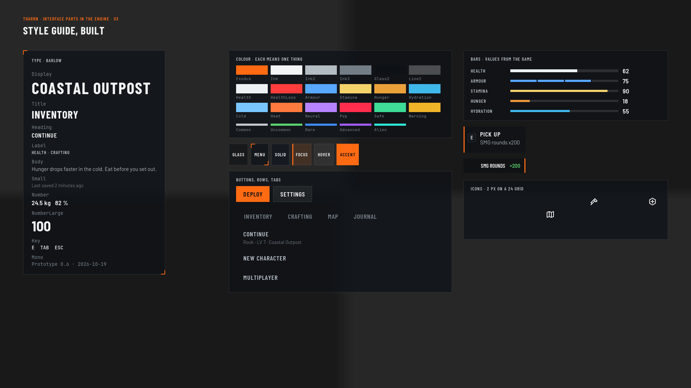
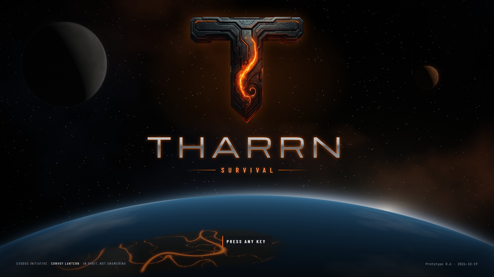
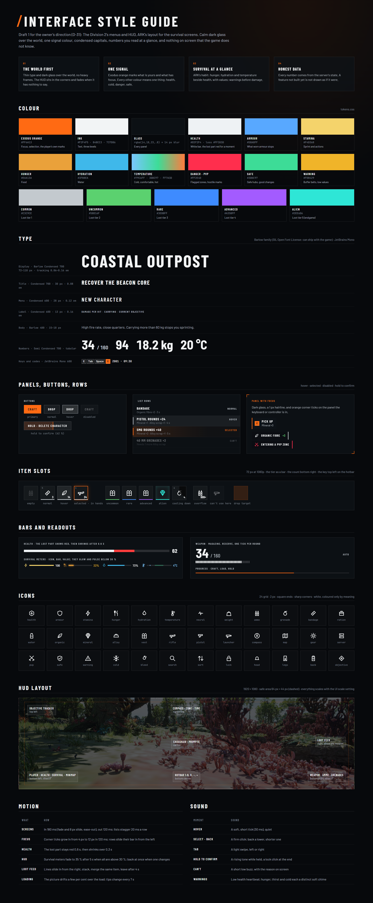
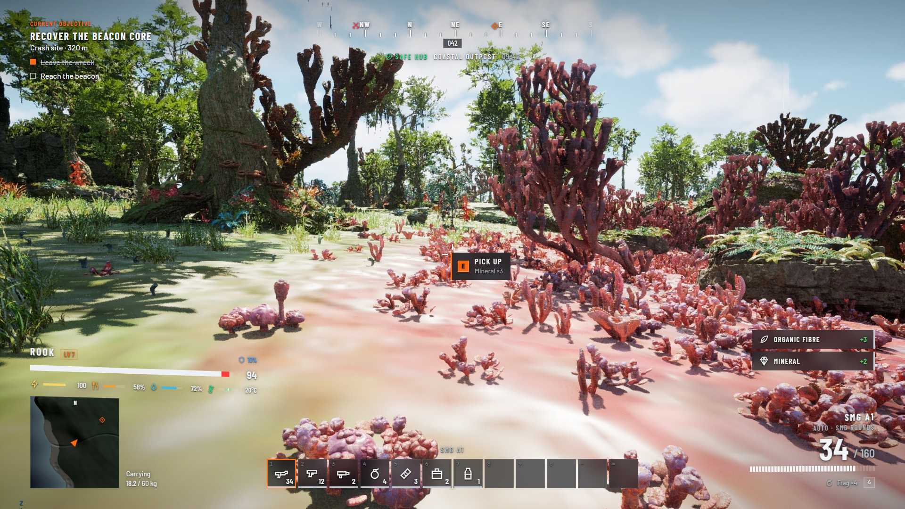
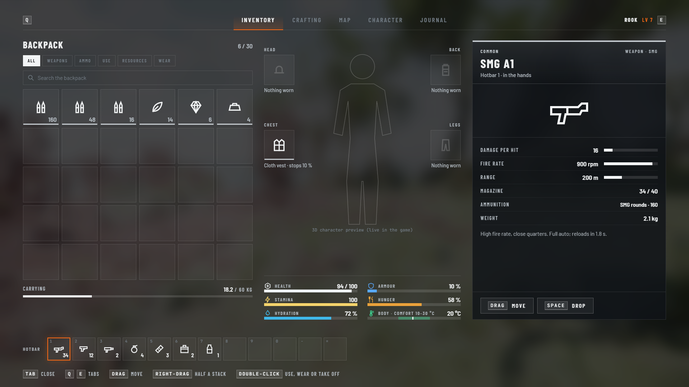
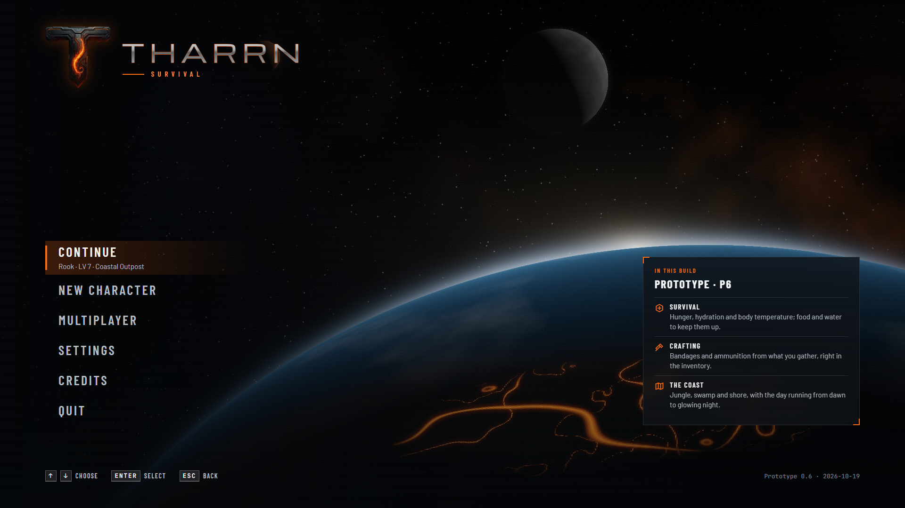
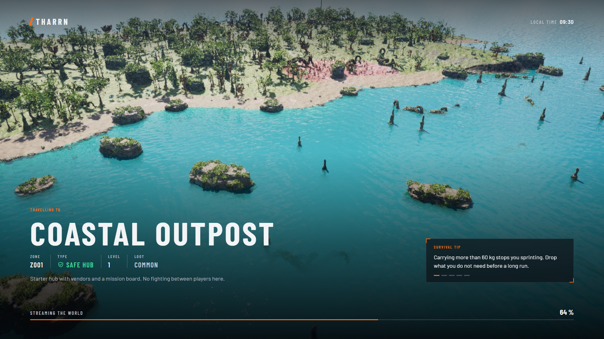

# The interface: GUI, UI and menus (2026-10-19)

The owner, 2026-10-19: "this chat is now for design and implementation of the games GIU, UI and Menu's, here we will
design and make top triple A quality game interface, Loading screen ect." Direction: "The Division 2 menus and HUD idea
with Ark survival type layout for the survival aspect, as this is a FPS / Survival" (D-31). The wiki's GUI, UI, Menus
tab shows this page's progress and pictures.

## 1. Direction

- **The Division 2's menus and HUD:** calm dark glass over the world, one signal colour, condensed capitals, numbers you
  read at a glance; the HUD in the corners, tilted a little as if it floats beside the player, fading when it has
  nothing to say; full-screen menus with tabs across the top (Q and E) and a card for the selected thing.
- **ARK's layout for the survival parts:** the inventory with the backpack left, the character and what is worn in the
  middle with the survival stats, the other side (an item, a container, a crafting station) right; hunger, hydration
  and temperature beside health with their values.
- **Honest data:** every number comes from the game's real state and data; a feature not built yet is labelled, not
  drawn as if it were.
- **Keyboard and mouse first (D-42; the owner, 2026-10-20: "Its a pc game so using a keyboard mainly, game controller
  is an extra"):** every screen, prompt and control is designed and tested with keyboard and mouse; the gamepad gets
  working equivalents (Common UI's navigation, its buttons on the prompts while one is in use) but never shapes a
  layout.
- The style is Tharrn's own (Exodus orange, Barlow type, its own icons), not copied art; Barlow is under the SIL Open
  Font License, so it can ship with the game.
- **Approved (D-36, 2026-10-19):** the style guide as drafted; the HUD's corners lean a little; Easy Game UI stays
  underneath (options, saves, input prompts, pause and menus) and is restyled in this look, while Tharrn's own C++
  HUD and inventory stay.
- **The main menu's scene (the owner, 2026-10-19: "The planet should look or resemble our game assets/map, the moons
  should look like the asset moon we have"):** Tharrn's planet is painted from the main map itself
  (`Tools/UI/make_planet_textures.py` in the game repo reads the Map chat's terrain data: the ten regions in their
  colours from orbit, shaded by the real heights, the rivers and lakes, the shallow coast; the Lattice in the mask's red,
  strongest under the desert and the plateau) for Tharrn's own planet material (`M_TharrnPlanet`: the map lit by a sun direction, drifting clouds, the
  Lattice glowing on the night side, the atmosphere's rim, on a smooth sphere of its own; the bundle's planet material
  samples virtual textures, which a scene capture leaves blurred, and its mesh shows corners this big), and the sky holds the bundle's moon and two planets as the game's sky does (`BP_SpaceMoonA`,
  `BP_SpacePlanetA`, `BP_SpacePlanetB`), all in one actor, `BP_TharrnMenuScene`. The menu itself is
  `WBP_TharrnMainMenu`, built from the shared parts by `Tools/UI/build_main_menu.py`; its entries are honest to the
  build (no saves yet, so Deploy starts the game; character creation and a server list show disabled).
- **The logo is the owner's T emblem** (concept 2026-10-19, `docs/ui/Title_MainMenu_Concept.png`): carved rock with
  a glowing crack, over a wide metal wordmark and SURVIVAL. Rebuilt for Tharrn (draft 2, a proposal): the T cut out
  as it is (`docs/ui/art/tharrn-emblem.png`, `art/cut_emblem.py`); the wordmark redrawn crisp; behind it Tharrn
  from orbit, the carrier Lantern's view (story.md): the ocean world's night side, the great island's rock glowing
  along the same kind of crack as the T (the Lattice and its signal), the two planets in its sky. In the game that
  scene is live (SkyAtmosphere from orbit), the crack pulses with the signal and the camera drifts; the mock-ups'
  backdrops are drawn by `art/render_orbit.py` as stand-ins.

Sources: `docs/ui/` holds the style guide's tokens and parts (`tokens.css`, `icons.js`), the mock-ups (`*.html`, drawn
over in-game captures in `docs/ui/backdrops/`) and `render.mjs`, which turns them into pictures in `pictures/ui/`
(`node projects/Tharrn/docs/ui/render.mjs`).

## 2. Progress

| Step | What | State |
|---|---|---|
| U1 | Style guide: colour, type, panels, buttons, rows, item slots, bars, icons, HUD layout, motion, sound | Done: approved 2026-10-19 (D-36) |
| U2 | Mock-ups of the main screens over in-game captures: HUD, inventory, main menu, loading screen; the title screen | Doing: draft 1 approved; the title screen and main menu redone from the owner's concept (draft 2) |
| U3 | Shared parts in the engine: the tokens as UMG styles, Barlow imported, the icon set, buttons, rows, slots, bars, prompts and toasts as C++ widget classes with Blueprint looks | Doing: built 2026-10-19 (the style asset, fonts, 38 icons, text, panel, bar, button, key prompt and toast; Easy Game UI restyled); item slots next |
| U4 | Main menu (with a live 3D scene behind) and loading screen | Doing: the main menu drawn by the engine over its live scene (2026-10-20): Tharrn's own planet material and sphere, the island from the main map, the bundle's moon and planets; the scene sits in the menu level; its actions wired the way Easy Game UI's own menu does them (it is one of Easy Game UI's screens now, on `WBP_EasyMasterWidget`: Deploy loads the new-game level through Easy Game UI's loader, Settings opens its options, Quit leaves; focus on Deploy for keyboard and gamepad); played in the game 2026-10-20 (it shows over the live scene after Easy Game UI's "press any key" stage, which becomes the title screen); mouse test 2026-10-20: Settings opens the options and Back returns, Quit leaves, Deploy now passes exactly what Easy Game UI's own New Game passes (no save slot, the new-game level's name; the first version put the name in the slot field), and the row and tab buttons stay clickable while selected (CommonUI blocks that otherwise); the scripted clicks on Deploy were taken by a floating Message Log window over the viewport (engineering guide, gotcha 128), so the owner's own click is its first real test; since the owner's test (2026-10-20) the game shows it (Easy Game UI's `MainMenuWidget` in `DA_TharrnUIConfig`; the owner: "i looked at a few things, ill decide later"), and OQ-31 is still open; one lit entry at a time (the pointer moves the focus: `UTharrnButton::bLightFollowsFocus`, built 2026-10-21; Deploy lit when it opens); a title screen next; saved locally until the owner calls the main menu right |
| U5 | HUD rebuilt in the new style; with it the build menu and build hints, on the Building chat's B4 build mode (split agreed 2026-10-20) | Doing: the build tool's HUD first (D-44, the owner 2026-10-21: "get UI chat to make a Radial menu instead"), in the game 2026-10-21 (built, test `Tharrn.UI.RadialPointing` passed, checked in a play session by `Tools/UI/check_build_hud.py`: the radial opened, pointing chose a piece, letting go made it the piece in hand): hold Q for a radial piece menu (categories on an inner ring, their pieces on an outer ring, point with the mouse, let go to choose; MST Pro's radial as the reference, not its widgets: D-08), the piece in hand and the build keys bottom right, why a piece cannot go under the crosshair, holding remove's progress, the new piece's name flashed when the wheel changes it, and the door's E prompt in the pick-up prompt's place (C++ `UTharrnRadialMenu`, `UTharrnBuildHud`; `Tools/UI/build_build_hud.py`; test `Tharrn.UI.RadialPointing`); the rest of the HUD later |
| U6 | Inventory and crafting in ARK's layout | Later |
| U7 | Pause menu, options (Easy Game UI, D-21), death and respawn, starting-location picker (D-28) | Later |
| U8 | Map, journal, character creation | Later |

## 3. Pictures

- 
- 
- 
- 
- 
- 
- 
- 
- 
- 
- 
