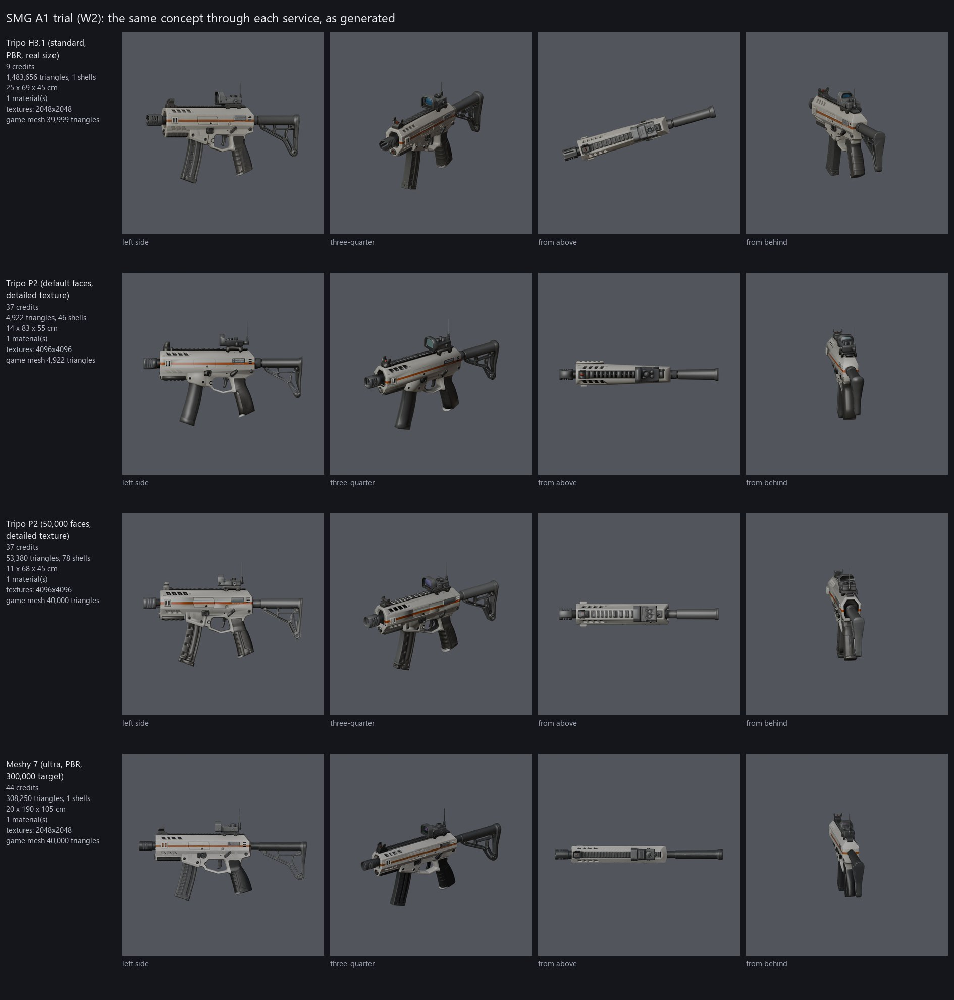
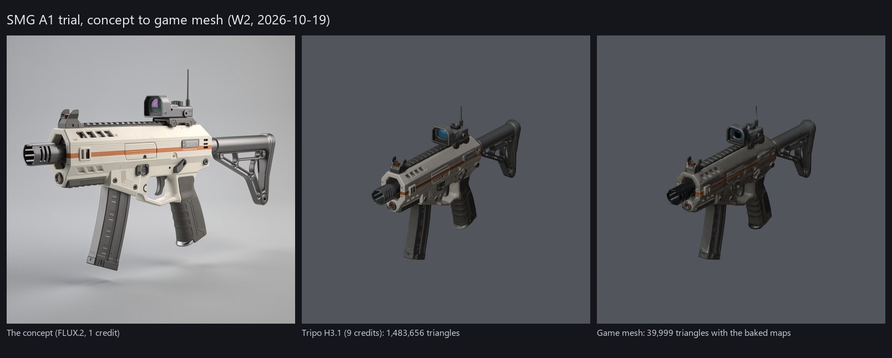
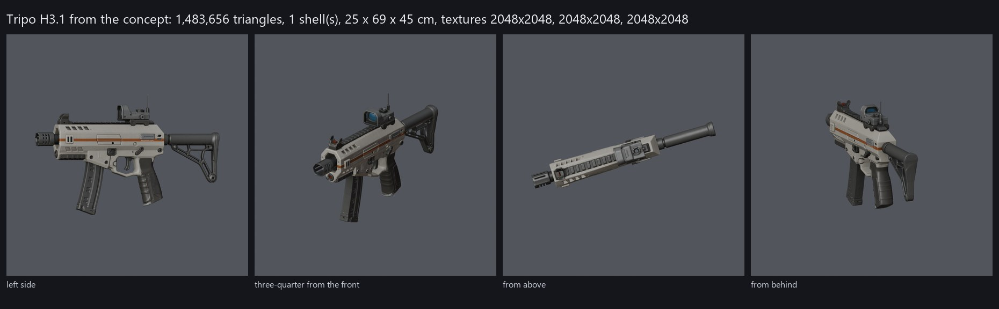
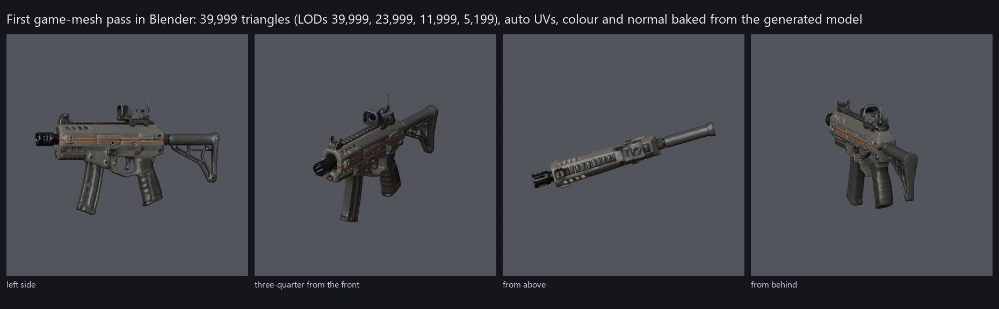
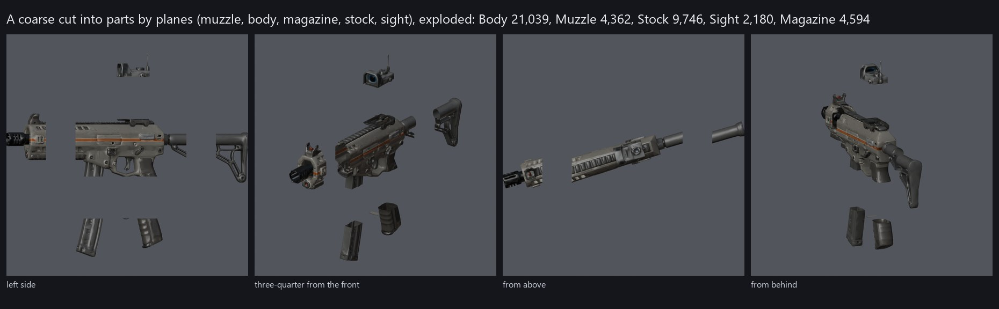
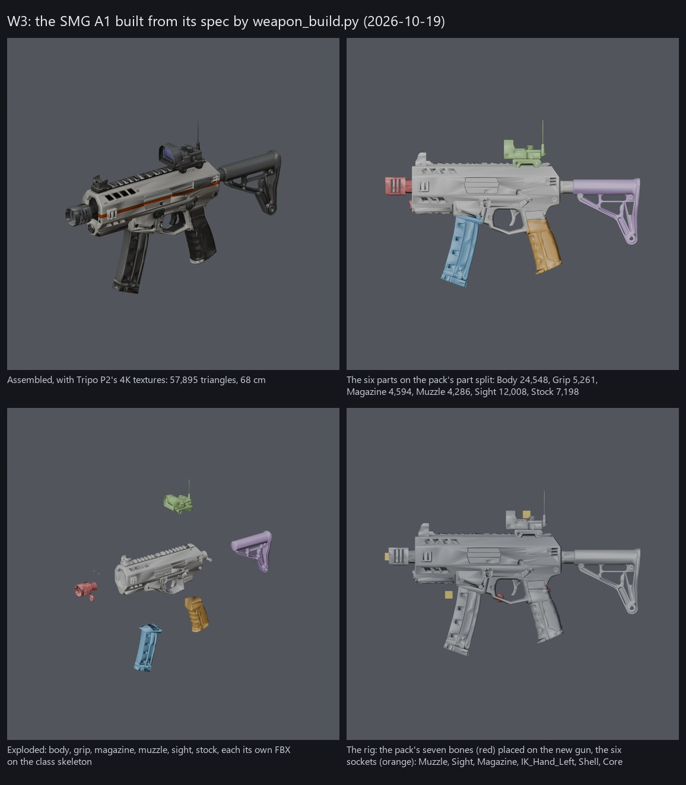
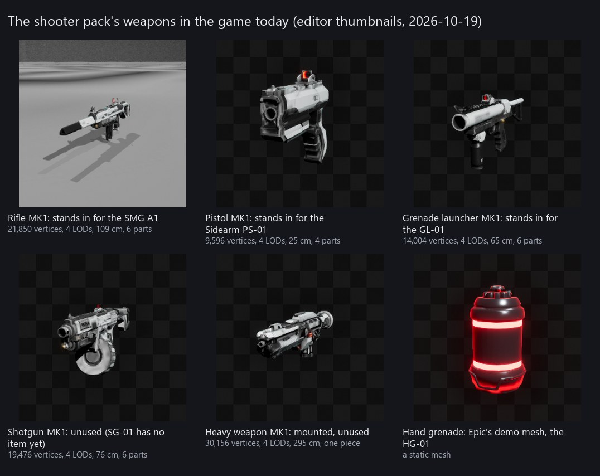
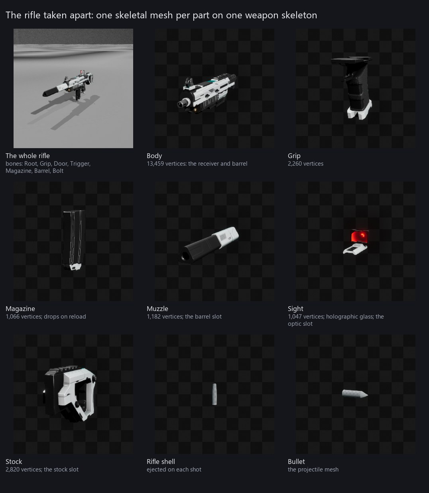
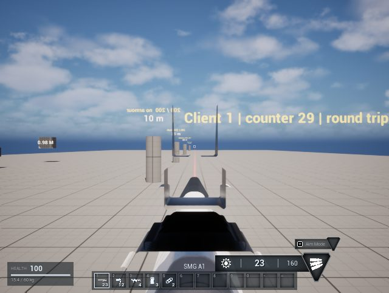

# Tharrn — Weapons and tools

The owner opened a **Weapons and Tools chat** on 2026-10-19: "Here we will disect the assets we have for guns, we will
use other AI that can help us Build the assests we need. we can access Blender. We will add Higgsfield, Tripo 3d or
better as needed for higher quality trilple A assets." (D-32). The wiki's Combat and arsenal tab is this chat's space.

This page is that chat's home: what the Multiplayer Shooter System (MSS) gives today, taken apart; what Tharrn's own
weapons, tools and attachments have to be (D-22); which AI and tools do which job and what is missing; the arsenal to
make; the steps. A new chat on this work reads this page, [GDD 02](gdd/02-combat.md), [deliverable 7](deliverables/07-weapons-and-attachments.md)
(the weapon and attachment data) and the [MSS reference](mss.md).

## 1. What the shooter pack has (measured 2026-10-19)

Read from the open editor through Unreal MCP without changing anything: every weapon's vertices per LOD, parts, bones,
sockets, size, materials and textures, and a thumbnail of each (section 9). The pack's weapons stand in for Tharrn's
(D-22, D-23): its rifle is the SMG A1, its pistol the Sidearm PS-01, its grenade launcher the GL-01, and Epic's demo
grenade the HG-01 (`Data/Items.csv`).

| Weapon (`/Game/DMD/Meshes/Weapon/`, MK1 bullet variant) | Stands in for | Vertices LOD0 to LOD3 | Parts (vertices) | Bones | Size | Material slots |
|---|---|---|---|---|---|---|
| Rifle (`SKM_LW_Rifle_Bullet_MK1`) | SMG A1 | 21,850 → 13,270 → 6,630 → 2,946 | Body 13,459; Grip 2,260; Magazine 1,066; Muzzle 1,182; Sight 1,047; Stock 2,820 | Root, Grip, Door, Trigger, Magazine, Barrel, Bolt | 109 × 30 × 8 cm | Weapon, Glass |
| Pistol (`SKM_LW_Pistol_Bullet_MK1`) | Sidearm PS-01 | 9,596 → 5,833 → 3,476 → 1,677 | Body 4,853; Grip 3,734; Magazine 141; Sight 868 | Root, Grip, Slide, Door, Trigger, Magazine, Barrel | 25 × 21 × 4 cm | Weapon, Glass |
| Grenade launcher (`SKM_GL_Impact_MK1`) | Grenade Launcher GL-01 | 14,004 → 7,850 → 4,421 → 1,994 | Barrel 3,804; Body 3,922; Grenade 1,216; Grip 927; Sight 2,428; Stock 1,707 | Root, Grip, Trigger, Barrel, Magazine | 65 × 27 × 6 cm | Weapon, Glass, Grenade |
| Shotgun (`SKM_LW_Shotgun_Bullet_MK1`) | nothing yet (SG-01 has no item) | 19,476 → 11,581 → 6,441 → 2,944 | Body 4,966; Grip 2,257; Magazine 1,266; Muzzle 7,788; Sight 953; Stock 2,246 | Root, Grip, Bolt, Trigger, Magazine, Barrel, Door | 76 × 34 × 19 cm | Weapon, Glass |
| Heavy weapon (`SKM_HW_Bullet_MK1`) | nothing (for turrets and vehicles) | 30,156 → 15,118 → 8,113 → 3,745 | one piece | Root, Grip, Door, Trigger, Magazine, Barrel, Bolt | 295 × 89 × 42 cm | Weapon |
| Hand grenade (`EpicGames_Demo/Meshes/Grenade/SM_Grenade`) | Frag Grenade HG-01 | a static mesh | — | — | — | — |

**How the pack builds a weapon.** Each gun is **modular**: one skeletal mesh per part (body, grip, magazine, muzzle,
sight, stock; the launcher has a barrel and a loaded grenade instead of a muzzle and magazine), all skinned to one
weapon skeleton per class (`SK_Rifle_Weapon`, `SK_Pistol_Weapon`, `SK_Shotgun_Weapon`, `SK_Grenade_Launcher`,
`SK_Heavy_Weapon`), plus the assembled mesh. The bones are what MSS's weapon animations move: the magazine drops and a
new one goes in on reload, the bolt or slide works on each shot, the trigger pulls. The pistol has a slide, the rifle
and shotgun a bolt. Every weapon also comes as an **energy** and a **laser** variant with its own parts and textures,
and the pack has a turret (`SK_Turret`) that fires the heavy weapon.

**Where things attach.** The weapon meshes have **no sockets**. The hand (`Weapon_TPS`), the magazine hands
(`Rifle_Magazine` and the like) and the throw hand are sockets on the character's skeleton (copied to Tharrn's player
by `setup_mss.py`); the muzzle is a child actor (`BP_Muzzle`) in the weapon Blueprint; and where the eye sits to look
through the sight (D-24) is a number tuned per weapon in Tharrn's `build_mss_weapons.py` (`EyeDistanceCm`), because
there is no sight socket to read.

**Materials and textures.** The gun's slot `Weapon` uses a white instance of a master instance of `M_Layer_Master`: a
layered material whose `Mask_Primary` texture picks which parts take which colour, so a weapon recolours without new
textures (the pack's "white" is its default paint). The sight's `Glass` is `M_Holographic_Sight` (the floating ring).
Every weapon has a **4K texture set**: `_D` colour (DXT1, sRGB), `_N` normal (BC5), `_R`, `_M`, `_E`, `_S` (roughness,
metal, emissive, specular; the "Optimized" set) plus the "Cinematic" masks for the layer master, all in Unreal's
`Weapon` texture groups. Four LODs come from the pack's LOD settings assets (`LS_Rifle` and the like: about 60 %, 30 %
and 13 % of LOD0), with a physics asset per part for dropped weapons.

**What this means for Tharrn.** The pack is already built the way the direction's attachments work: its muzzle,
stock, magazine and sight parts are the barrel, stock, magazine and optic slots of deliverable 7, one mesh each, swapped
on one skeleton. Tharrn's own models keep that construction (section 3) and gain what the pack lacks: Tharrn's look,
sockets, a core slot, scopes and tools.

## 2. What exists in the game today

- `BP_TharrnWeapon_SMG`, `_Pistol` and `_Heavy` (`/Game/Tharrn/Weapons/MSS`): children of MSS's rifle, pistol and
  grenade launcher MK1, driven by Tharrn's C++ weapon component (D-23); `BP_TharrnGrenadeRound` and
  `BP_TharrnHandGrenade` (D-24). Built by `Tools/Weapons/build_mss_weapons.py`.
- Data: `Data/Weapons.csv` (AR01, SMG_A1, SG01, PS01, MR01, GL01, HG01 with reload, aim, spread, falloff, blast and
  zoom columns), `Data/WeaponRecoil.csv`, the weapon and ammunition items in `Data/Items.csv`. No `Attachments.csv`
  yet (deliverable 7 proposes 11 attachments in five slots).
- Hits, zones, armour, falloff, recoil, spread, projectiles and blasts in C++ (P3), checked by the network and MSS tests.
- Not built: picking weapons up from the ground (MSS's interaction), attachments and scopes, the energy fire mode (beam
  or charge), melee and tools, Tharrn's own models, sounds of Tharrn's own.

## 3. What a Tharrn weapon model has to be (proposal)

The contract every model meets before it goes into the game, so MSS's handling, Tharrn's C++ and the attachments keep
working with no per-weapon code:

| Point | Rule (proposal) |
|---|---|
| Construction | Parts as separate skeletal meshes on **MSS's weapon skeleton for the class** (the rifle skeleton for SMGs and rifles, the pistol skeleton for sidearms, the launcher skeleton for the GL-01), with the same bone names, so MSS's reload, fire and magazine animations play unchanged. New classes (the Mass Driver, the Arc Beam) get a skeleton of their own on the same pattern |
| Parts | Body, grip, magazine, muzzle, sight, stock, and a **core** (a module in the body for the alien-technology slot); a part is one mesh, one material, one physics body. An attachment is a part file that replaces the default part |
| Sockets on the skeleton | `Muzzle` (flash, tracer and shot origin), `Sight` (the eye for the view through the sight, D-24, replacing the hand-tuned numbers), `Magazine` (MSS's magazine drop), `IK_Hand_Left` (the front hand), `Shell` (ejection), `Core` (the core's glow) |
| Scale and pivot | Real-world centimetres, Root at the grip where the hand holds it, the barrel along +Y and Z up, as the pack's (measured: the rifle's muzzle part sits at +63 cm, its stock at -17 cm, its grip at the origin) |
| Triangles | About 40,000 to 80,000 for the whole gun at LOD0 with its parts (the pack's rifle is about 40,000: the mark to beat, not to multiply), 4 LODs through LOD settings assets like the pack's; Nanite is not used for skeletal meshes |
| Textures | One 4K set for the body (colour, normal, packed roughness, metal and ambient occlusion, emissive where there is a glow), 2K per part; Tharrn's weapon master material with the pack's idea of colour layers, so rarity and tiers tint a gun without new textures |
| Look | From the story and the tier (D-37, section 5): the Issue tier is the base model, the other tiers are part swaps and material layers on it; not the pack's and not copied art |
| Checks | Imported through the import tool (W4) with no warnings; the same picture through the sight on every weapon; the MSS test (draw, fire, reload, swap, aim, wheel) passes with the new model; the owner's yes on pictures in the game |

## 4. Which AI and tools, and what is missing

The project's 3D skills (`3d-production-routing` and the ones it points to: `image-reference-workflow`,
`character-sheet-pipeline`, `higgsfield-workflow`, `fal-ai-generation`, `materials-to-game`, `blender-game-animation`,
`gameplay-visual-review`) already cover each step; what matters is which service is connected and what it costs.

| Job | Tool | Connected now? | Cost |
|---|---|---|---|
| Concept sheets per weapon (three-quarter view, strict side and top views, the parts laid out) and inventory icons | Higgsfield's image models through its MCP (this chat); or Lychee Studio's text-to-image step | Yes: **Higgsfield Plus** since 2026-10-19 (D-35; 1,200 credits on activation, 1,082 after the trial) | 0.25 to 1.25 credits an image |
| Image to a high-detail 3D model | Higgsfield's 3D models: **Tripo H3.1** (one image or 2 to 4 views; PBR), **Tripo P2** (FBX or GLB, quad mesh, up to 50,000 faces, "extreme" texture quality), Meshy 7 (PBR, low-poly mode), Hunyuan3D v3.1 Pro, SAM 3 3D; Meshy remesh and retexture | Yes, through the MCP | 5 to 25 credits a model (Higgsfield's prices on 2026-10-19: Tripo 5, Hunyuan3D 3.1 Pro 16, Meshy with PBR 25) |
| The same, in the owner's Lychee Studio project | [Lychee Studio](https://lychee-studio.ai/): a node workspace from text to image to 3D ("Image to 3D", "Multiview", "Texture Model", "Props Extraction", "Game Export (FBX/glTF)"); its page says props can be textured, rigged and exported to GLB and FBX | The owner's account, in the browser; no MCP or CLI found | Per seat and credits: Starter 20 €/seat/month (its page, 2026-10-19) |
| Retopology to the budget, UVs, baking the high-poly's detail, splitting into parts, rigging to MSS's weapon skeleton, sockets, LODs, FBX export | **Blender 4.1** (installed under Program Files), scripted by Claude and run headless (`blender.exe --background --python`) | Yes | Free |
| Import, materials, LOD settings, physics asset, the weapon Blueprint child, the data row, pictures in the game | Unreal MCP (`SkeletalMeshTools.import_file`, materials, Blueprints) and `Tools/Weapons/` scripts | Yes | Free |
| Sounds of Tharrn's own | MSS's for now; later the `game-audio-workflow` skill | — | Later |

**What is missing, and what is not (the owner asked):**

- **Nothing new is needed to start.** The trial of one weapon (W2) runs on the Higgsfield MCP's free credits, the owner's
  Lychee project and Blender.
- **Higgsfield CLI:** installed as `@higgsfield/cli` 1.1.26, but its program file (`vendor/hf.exe`) is missing, so it
  does not run; `npm i -g @higgsfield/cli` reinstalls it. Only needed for the Blender-side route or scripted batches;
  the MCP does the same jobs from this chat.
- **The plan: taken.** The owner activated Higgsfield Plus on 2026-10-19 (D-35): 1,000 credits a month, about 13 weapons
  a month at a concept and two Tripo P2 tries each. A Lychee Studio seat is not needed unless the owner wants its leg
  compared (section 10).
- **fal.ai** (`FAL_KEY`, the `fal-ai-generation` skill): not connected. The same Tripo, Meshy and Hunyuan models through
  another account, plus material-map generation; optional, only if Higgsfield's plan is not taken.
- **Not needed:** a Blender MCP (Blender runs headless from scripts), a direct Tripo account (its H3.1 and P2 are in
  Higgsfield; a direct account only adds Tripo's own extras), Substance (bakes happen in Blender, the material in Unreal).

**Why generated meshes are not dropped into the game as they come.** Image-to-3D gives one sculpted mesh with baked
textures: no parts, no bones, no sockets, uneven topology, and a texture that does not recolour. The generators are
for the **high-poly source**; the game mesh is made from it in Blender (W3), the way a studio bakes a sculpt down. That
is also what keeps the attachments working: a part is only a part if it is a separate mesh on the shared skeleton.

## 5. The arsenal and the look (proposal, OQ-20; revised 2026-10-19 for D-37)

**Decided as proposed on 2026-10-19 (D-38), with the starting kit (OQ-28).**

The owner, 2026-10-19: "have a look at the game's progression, players start out with low end weak weapons, mods to
weapons make them better, advanced tiers get better. The look and style of the weapon is based on the story." (D-37).
So the arsenal follows the five loot tiers of GDD 04 and [story.md](story.md#10-loot-blueprints-mastery-and-reputation)
§10, each tier has a maker in the story and a look of its own, and the mods (deliverable 7's attachments) are the steps
between tiers. Everything below is a proposal, aligned on 2026-10-19 with the story's tier guide
([story.md](story.md#13-tiers-how-each-age-of-the-game-looks-and-feels) §13, the same five makers), which sets two rules
for every chat: **every crystal glow is one colour**, the interface's Neural token (`--neural`, #b783ff), so a glow means
the Lattice anywhere; and **the pulse silences Initiative, Flats and Contract technology** for a few seconds while Remnant
and Choir technology keeps working.

**Tiers.** One per loot tier, each from a maker the story already has:

| Tier | Maker in the story | Look | How you get it | Stats and slots |
|---|---|---|---|---|
| **Common: Wreck** | Initiative issue pulled from Lantern's crashed landers | Scorched off-white polymer, tape and wire, a missing stock or sight (iron sights only), bare alloy where the paint burned, the orange stripe a trace | The starting kit and the coast's drops (Act I) | Damage × 0.85, handling × 0.9; two of the five mod slots work, the rest are damaged |
| **Uncommon: Issue** | The Initiative's fabricator at the Coastal Outpost prints the convoy's standard pattern clean | The clean colony print: matte off-white polymer, a dark alloy receiver, the Exodus orange stripe, stencilled serials (the trial's SMG, section 10) | Crafted at a fabricator from alloy and mineral, no blueprint; the forest's drops (Act II) | Damage × 1.0; all five slots |
| **Rare: Contract** | The Consortium's security contractors: machined, heavier, corporate | Gunmetal and matte black, machined edges, yellow-and-black hazard trim, serial plates | A blueprint from Rare sources (the Hollow, the Research Hub, dungeon chests, Trusted rank), built at the assembly bench; Consortium vendors | Damage × 1.15, recoil × 0.9; one mod built in |
| **Advanced: Remnant** | Meridian's survivors, eleven years adapting Initiative guns with Lattice crystal | A weathered Issue base with station brass and copper conduits, crystal grafts glowing in the Lattice's light (the Neural colour) | A blueprint from Advanced sources (the Crystal Expanse, the Contested Ruins, the plateau, the Echo Caverns, dungeon bosses, Sworn rank); needs biotech cores and energy crystals | Damage × 1.3; works through a pulse (below) |
| **Alien: Choir** | Grown from the Lattice's own crystal: Alien Synthesis, raid and world bosses, Legend rank, the archipelago | Dark crystal and alloy with no visible mechanism, glowing seams (the Neural colour) that sing the Choir's tones; the energy weapons' home | A blueprint and an alien core | Damage × 1.5; the core slot takes Alien cores; works through a pulse |

**Mods are the steps between tiers.** Deliverable 7's eleven attachments keep their own rarities (a Common compensator
to an Alien phase core). A Wreck gun with its two working slots and Common mods is the first upgrade; the Issue gun
opens all five; Rare and Advanced mods come from blueprints, dungeon chests and weapon mastery (story.md §10: ranks
3, 6 and 10 of a family give a barrel, an optic and a core; the Tech tree's Tinkerer makes them cheaper). Mods are
part files that swap on the class skeleton (section 3), so every tier of a weapon takes every mod of its family.

**The pulse, from the story.** Initiative technology falls silent at every pulse (story.md §1), and the story's tier
guide makes it the rule for every chat: weapons with electronics, which is every holographic sight and energy cell of
the Wreck, Issue, Flats and Contract tiers, go dark for the pulse's few seconds; Remnant and Choir weapons do not. The
hook makes the higher tiers matter beyond numbers and gives the pulse a combat beat; it is a line in
`Data/WeaponTiers.csv` and a few seconds of the sight's material.

**Each weapon's home in the story:**

| weapon_id | Weapon | Story home | Tiers | Wave | Note |
|---|---|---|---|---|---|
| SMG_A1 | SMG A1 | Initiative issue; the default starter | Wreck to Choir | 1 | The trial's model is its Issue tier |
| PS01 | Sidearm PS-01 | Initiative issue | Wreck to Advanced | 1 | |
| GL01 | Grenade Launcher GL-01 | Initiative; the squad's cache (the Soldier's intro quest) | Issue to Advanced | 1 | Not in the starting kit (OQ-28) |
| HG01 | Frag Grenade HG-01 | Initiative | Common | 1 | Crafted; no tiers |
| AR01 | Assault Rifle AR-01 | Initiative issue; the Soldier's starter | Wreck to Choir | 2 | No item yet |
| SG01 | Shotgun SG-01 | The Free Camps' scavenger gun in the Flats look (story.md §13): rust, cast stone, pipe, plate, tape, hand-painted white marks; traded at the Flats | Common to Rare | 2 | Pellets still proposed (deliverable 7) |
| MR01 | Mass Driver MR-01 | The Consortium's contract long gun | Rare to Alien | 3 | Out of the heavy slot (D-24); the Contract tier's signature |
| EB01 | Arc Beam EB-01 | The Remnant's crystal hybrid; the Choir's version is the Alien energy weapon | Advanced to Alien | 3 | Needs the beam fire mode in C++ |

**How the tiers are made.** One model per weapon at the Issue tier (the base, six parts). The other tiers are part
swaps and material layers on it, the way the building tiers work on the same shapes (D-33): Wreck replaces the stock
and sight with damaged parts and burns the paint through the material's layers; Contract swaps the muzzle, stock and
grip for machined ones and recolours; Remnant adds a crystal core part and a conduit panel and keeps the weathering;
Choir replaces the body's skin and the core with crystal parts and the glow. About twelve part files a weapon instead
of five models. Stats per tier in `Data/WeaponTiers.csv` (tier, damage, handling and recoil multipliers, slots open,
blueprint, core, pulse-proof), applied by the server when a weapon's stats are built (D-04).

**The starting kit (OQ-28).** Today's kit (P3's test kit: SMG, sidearm, launcher, three grenades, 160 rounds) is more
than a crash survivor wakes with. Proposal: the origin's weapon at the Wreck tier (the SMG A1, or the Soldier's AR-01)
with one magazine, the sidearm, a bandage and the tools of section 6; the launcher comes with the Soldier's cache and
the Free Camps' trade. Agreed with the Story chat on 2026-10-19: it makes the `Data/StartingKit.csv` change together with
the origins (P8); the test kit stays until then.

**Order of making.** Wave 1: the Prototype's guns at the Issue tier plus the Wreck variant, the start of the game.
Wave 2: the mods, the rifle and the shotgun. Wave 3: the Contract, Remnant and Choir variants with the story's acts
(the vertical slice's Act III wants the first Remnant weapon), the Mass Driver and the Arc Beam. Tools run beside the
guns once the pipeline works (section 6).

## 6. Tools (proposal, OQ-21)

**Decided as proposed on 2026-10-19 (D-39).**

"Tools" are the hand tools of the survival loop. The design names them in three places: the map's harvesting (trees cut
with a **hatchet**, rocks mined with a **pickaxe**, plants gathered by hand or with a **knife**; [map-design.md](map-design.md#4-harvesting-built-into-the-map-from-the-start)),
the starter loadout's **field scanner** (GDD 01) and the **build tool** on the hotbar (D-30, [building.md](building.md#7-the-building-system)).

| Tool | Use | Logic lives in | Model from this chat |
|---|---|---|---|
| Hatchet | Cutting trees; a weak melee weapon | Harvesting (map chat, M5) | Yes |
| Pickaxe | Mining rocks, ore and crystal | Harvesting (M5) | Yes |
| Knife | Harvesting plants and hides; the quietest melee weapon | Harvesting (M5), combat (P3) | Yes |
| Field scanner | Shows resource nodes and creatures' weak points nearby (proposal: what it does is open) | New, with the HUD (UI chat) | Yes |
| Build tool | Placing building pieces (the ghost preview) | Building (B4) | Yes |

The hatchet, pickaxe and knife take the Flats look (story.md §13: rust, pipe, plate, tape, hand-painted marks); the field
scanner and the build tool are Initiative issue. Proposal: a tool is a row in `Data/Weapons.csv` with a new hit type, `melee`: a short-range swing the server checks
like a shot (the same rewind and checks as C-04), so the harvest system only has to listen for the hit. Tools use
MSS's one-hand pose and a Tharrn swing animation (a montage on the player's skeleton, made in Blender with the
`blender-game-animation` skill). Which tools, and what the scanner does: the owner's call.

**Hand-over with the Building chat (agreed 2026-10-20).** Until the build tool is on the hotbar (W8), B starts build
mode from the Building chat's own mapping: starting it puts the weapon in hand away through the hotbar, drawing any
weapon ends it. From W8 the build tool is a row in `Data/Weapons.csv` with no hit (it never swings; the melee hit is
the hatchet's, pickaxe's and knife's) and an item on the hotbar: drawing it calls the building system's
`SetBuilding(true)`, putting it away `SetBuilding(false)`. While building, the Building chat's mapping takes left and
right mouse, R and the wheel; repairing and upgrading with the tool are the Building chat's; the model gets a Core
socket at its emitter for the ghost preview's beam.

## 7. Steps

| Step | What | Done when | State |
|---|---|---|---|
| W0 | The pack's weapons taken apart and pictured; the model contract, the AI and tools, the arsenal, the tools and the steps proposed (this page); the wiki's Combat and arsenal tab | The owner has read it | Done 2026-10-19 |
| W1 | The owner's choices: the look and order (OQ-20), the tools (OQ-21), the generation service and plan (OQ-22) | Decisions logged | Done 2026-10-19: D-38 to D-40 |
| W2 | Trial on one weapon (the SMG A1): a concept sheet, then the same sheet through Tripo H3.1, Tripo P2, Meshy 7 (Higgsfield) and Lychee Studio; each result split, retopologised and baked in Blender; compared on parts, topology, texture and time | A picture of the four side by side; the owner picks the service | Done 2026-10-19: Higgsfield's three services compared (section 10); Tripo P2 at 50,000 faces chosen (D-40) |
| W3 | The Blender tool: `Tools/Weapons/Blender/weapon_build.py` turns a high-poly into parts on the class skeleton with sockets, LODs, bakes and an FBX per part, from a small JSON spec per weapon | The SMG rebuilds from its spec with no hand steps; a check script measures triangles, sockets and bone names | Done 2026-10-19: the SMG A1 rebuilds from its spec with no hand steps and the check passes (section 11) |
| W4 | The import tool: `Tools/Weapons/import_weapon.py` imports the FBX parts under `/Game/Art/Weapons/<id>/` (`WP_` meshes, `T_` textures, the owner's conventions), makes the material instances, LOD settings and physics assets, and the Tharrn weapon Blueprint child that uses them | Import with no warnings; the MSS test passes with the new model | Next: prepared 2026-10-20 (section 12), unrun; runs on the owner's go in the first editor slot after the Map chat's window, through the Master chat |
| W5 | Wave 1 in the game: SMG A1, Sidearm PS-01, Grenade Launcher GL-01 and its round, Frag Grenade HG-01; the view through each sight from its `Sight` socket; pictures in the game | The owner's play-test | Later |
| W6 | Attachments: `Data/Attachments.csv` (deliverable 7), part files for the eleven, the swap on the server with the stats rebuilt (D-04), scopes with their zoom, the weapon mod screen with the UI chat | Tests; the network test with two clients; made-up swaps refused | Later |
| W7 | Wave 2 and 3: AR-01, SG-01 (pellets decided), MR-01, EB-01 with the beam fire mode in C++ | Each passes the MSS and network tests | Later |
| W8 | Tools: hatchet, pickaxe, knife, scanner, build tool models and the `melee` hit type; the swing animation; wired to harvesting (map chat) and building (building chat) | Harvest a tree and a rock with two clients | Later |
| W9 | Icons in the interface's style and Tharrn's own weapon sounds | The UI chat's yes; the sound bank | Later |

## 8. Working beside the other chats

Three chats share one editor (the map, the interface, the building; the engineering guide's gotcha 4). This chat only
reads the open editor while others work, and makes models outside it (Blender, the generation services). Imports (W4)
touch assets, not the open level, and go under `/Game/Art/Weapons/` and `/Game/Tharrn/Weapons/`; nothing is saved
under the pack's folders (D-08). Play sessions for pictures and tests wait for the owner's go while another chat is
using the editor.

## 9. Pictures

- 
- 
- 
- 
- 
- 
- 
- 
- 

## 10. W2 trial results (2026-10-19, the Higgsfield leg)

The owner said go on 2026-10-19. The free plan's 10 credits paid for one concept and one 3D model; the default image
model (`gpt_image_2_5`) is locked to paid plans, so the concept came from FLUX.2.

| Step | What was done | Result | Cost |
|---|---|---|---|
| Concept | FLUX.2 pro at 1K, one image, from a prompt written to section 5's look (colony-printed off-white polymer, dark alloy receiver, one orange stripe, reflex sight, skeleton stock, 40-round magazine), three-quarter view on a plain grey background | A clean, plausible SMG that matches the look on the first try | 1 credit |
| 3D | Tripo H3.1 image-to-3D, standard geometry and texture, PBR on, real-world size on | A faithful model: 1,483,656 triangles in one welded shell, 69 cm long, 45 cm tall with the magazine, 25 cm wide with the stock, one material with 2K colour, normal and packed occlusion-roughness-metal textures; the stripe, vents, plate and sight are all there; the thin antenna on the sight came through as a sliver | 9 credits |
| Blender pass | `inspect_glb.py` (headless): measure, render four views, decimate to the 40,000 budget, auto UVs, bake colour and normal from the generated model at 2K, four LODs as FBX, a coarse cut into muzzle, body, magazine, stock and sight by planes | LOD0 39,999 triangles, LODs 23,999, 11,999, 5,199; the bake keeps the panel detail at this size; the cut shows parts can be separated (body 21,039, stock 9,746, magazine 4,594, muzzle 4,362, sight 2,180 triangles). Files in `D:\Tharrn\Saved\ClaudeScratch\weapons_trial\out\game\` (outside Git) | Free, about 3 minutes |

**Findings.** (1) Image-to-3D from one good concept gives a usable high-poly source at the first try; the pipeline's
shape (section 4) holds. (2) H3.1's model is one welded shell (an earlier count of 215 was the glTF import's unwelded UV seams), so its
parts have to be cut; Tripo P2's models come as separate pieces instead (below). (3) Decimation alone gives a
usable LOD set for third person, but the sight glass, the magazine well and the trigger guard want a proper retopology
for the view through the sight (W3). (4) The baked normal and colour maps work; roughness and metal come from Tripo's
packed map and are not yet re-baked onto the game UVs (W3). (5) Real-world size came out right from the prompt's
"about 65 cm", so the import needs no rescale.

### The other legs (2026-10-19, after the owner took Higgsfield Plus)

The same concept image through the other services, each measured by the same Blender pass (the shell counts after
welding the import's UV-seam splits):

| Service and settings | Credits | Triangles | Pieces (shells) | Size | Textures | What it is |
|---|---|---|---|---|---|---|
| Tripo H3.1, standard geometry and texture, PBR, real size | 9 | 1,483,656 | 1 | 69 cm, right | 2K colour, normal, packed ORM | A sculpt: a high-poly source to bake from, no parts |
| Tripo P2, default faces, detailed texture, PBR, real size | 37 | 4,922 | 46 | 83 cm (guessed long) | 4K colour, normal, ORM | A finished low-poly game mesh with crisp 4K maps; too few triangles for the view through the sight |
| **Tripo P2, 50,000 faces, detailed texture, PBR, real size** | 37 | 53,380 | 78 | 68 cm, right | 4K colour, normal, ORM | **The best fit:** inside the 40,000 to 80,000 budget as generated, the sharpest hard-surface edges, and real separate pieces (stock, magazine, sight, muzzle), so the part split becomes grouping pieces rather than cutting |
| Meshy 7, ultra, PBR, 300,000 target | 44 | 308,250 | 1 | 190 cm (no real size; set on import) | 2K colour, normal, ORM | A clean mid-poly, lying along X; needs retopology, rescale and cutting like H3.1 |

**Recommendation (OQ-22):** Tripo P2 at 50,000 faces as the main route, about 37 credits a try, with H3.1 at 9 credits
as the cheap first look at a new concept and as a high-poly source when a part needs more baked detail. Meshy adds
nothing here and costs the most. Lychee Studio's leg is optional: Claude's browser tools are not connected in this
chat, so it would be the owner's, by uploading `docs/pictures/weapons/trial/smg_concept_flux2.jpg` into the Lychee
project, running Image to 3D and Game Export (FBX or glTF), and dropping the file in
`D:\Tharrn\Saved\ClaudeScratch\weapons_trial\`; the same Blender pass measures it. The three services' files, renders and
reports are in that folder's `out`, `out_p2`, `out_p2_50k` and `out_meshy` (outside Git).

**What W3 takes from this.** Start from P2's pieces: group them into the class skeleton's parts (body, grip, magazine,
muzzle, sight, stock), weld and clean each, bake P2's 4K maps onto the parts' own UVs, make the LODs, add the sockets and
the bones. Keep the plane cut as the fallback for one-shell models.

## 11. W3 results (2026-10-19): the SMG A1 built from its spec

The owner: "all as proposed, go ahead with W3". The tool is `Tools/Weapons/Blender/weapon_build.py` in the game repo, run
headless by Blender 4.1 on a spec (`Tools/Weapons/Blender/specs/SMG_A1.json`), with `weapon_check.py` checking the
result against the contract (section 3). Both pass on the SMG A1 with no hand steps; a change is a re-run.

**What the tool does.** It imports the pack's weapon of the class from FBX (`Tools/Weapons/export_mss_weapons.py`,
run once in a background editor) to read the muzzle axis and the skeleton; lays the generated model out like it
(the barrel along the pack's axis, real length, the hand point on the grip at the origin); welds the import's
split vertices and separates the generator's pieces (78 from Tripo P2); groups the pieces into the parts by where
each sits on the gun (fractions along the barrel, up and sideways, in the spec); cuts the regions the generator left
in one piece (the magazine and the grip, cut out of the receiver by boxes in the same fractions, with bmesh planes,
since booleans fail on generated meshes); builds the armature with the pack's bone names, hierarchy and bind
orientations (the root bone, which Unreal's FBX export turns into the armature node, is restored as a bone) and
places each bone on the new gun's parts; skins every part rigidly to its bone; adds the six sockets as `SOCKET_`
empties on bones; writes an FBX per part and one of the whole gun, the textures as PNG, LOD triangle counts, a
report and pictures.

| Part | Triangles | Size (cm) |
|---|---|---|
| Body | 24,548 | 10.7 × 45.7 × 22.0 |
| Grip | 5,261 | 5.8 × 9.5 × 14.7 |
| Magazine | 4,594 | 6.4 × 11.0 × 19.2 |
| Muzzle | 4,286 | 4.8 × 9.7 × 12.6 |
| Sight | 12,008 | 7.3 × 11.2 × 12.6 |
| Stock | 7,198 | 5.1 × 17.9 × 17.8 |
| **Whole** | **57,895** | 10.7 × 68.0 × 44.8 |

| Part | LOD0, LOD1, LOD2, LOD3 (60 %, 30 %, 13 %) |
|---|---|
| Body | 24,548, 14,727, 7,363, 3,191 |
| Grip | 5,261, 3,156, 1,577, 683 |
| Magazine | 4,594, 2,756, 1,378, 597 |
| Muzzle | 4,286, 2,570, 1,285, 557 |
| Sight | 12,008, 7,204, 3,601, 1,561 |
| Stock | 7,198, 4,318, 2,159, 935 |

Bones: Root at the grip's hand point, Grip, Trigger, Magazine, Barrel, Bolt, Door placed on the parts; sockets Muzzle (on
Barrel), Sight, Magazine (on Grip), IK_Hand_Left, Shell, Core. Textures: Tripo P2's 4K colour, normal and packed
occlusion-roughness-metal maps, shared by all parts (one material, as the pack's weapons). Files in
`D:\Tharrn\ArtSource\Weapons\SMG_A1\` (fbx, textures, pictures, the .blend, report.json): new in the game repo, not
yet tracked (the owner decides at the commit; FBX and PNG belong to LFS).

**What W4 has to verify in Unreal.** The bone orientations round-trip (Blender's FBX import of the pack's rifle and
export of the new parts use the same axis settings, so the pack's reload and fire animations should play on the new
parts: the import test tells); the armature node (`Armature`) is stripped on import; the sockets come through; LODs
from the pack's LOD settings. Not done in W3: the Wreck variant's damaged parts (W5, with its own concept), bakes
(not needed for P2's textured pieces; the inspect script's bake stays the fallback for high-poly sources).

## 12. W4 prepared (2026-10-20): what runs on the owner's go

Written off the editor during the Map chat's window, unrun; the run takes the first editor slot after the window,
through the Master chat, once the owner says go.

| Piece | Where | What it does |
|---|---|---|
| The import tool | `Tools/Weapons/import_weapon.py` (game repo), a background-editor script like the export | Textures `T_<id>_diff`, `_norm` (a glTF normal map, green flipped), `_orm` (packed occlusion, roughness, metal) into `/Game/Art/Weapons/<id>/`; the master material `M_TharrnWeapon` (colour times a Tint, normal, the packed map, a GlowColor in the Neural token times a Glow strength for the tiers' crystal light) under `/Game/Art/Weapons/Materials/`, made once; `MI_<id>` on it; the six parts and the whole gun as skeletal meshes `WP_<id>_<Part>` on the pack's class skeleton, with the pack's LOD settings (the modular ones for Body, Muzzle and Stock, the small ones for Grip, Magazine and Sight, as the pack's own parts), a physics asset each, the sockets on Body. Checks: on the class skeleton with no skeleton of its own, the rig's bones, the six sockets, one material slot, the length within 5 percent of the spec, the muzzle ahead of the stock along +Y, LODs. Writes a report; `RESULT ok` or `failed`. |
| The pack skeleton's retargeting | The same script (`TH_RETARGET_RELATIVE=0` leaves it) | Every bone but the root of the class skeleton to AnimationRelative translation: the pack's reload moves the new magazine from where it sits on the new gun instead of jumping to where the pack's magazine was; the pack's own meshes play as before. Pack content, so it runs again after a restage, like `setup_mss.py` |
| The Blueprint hookup | `Tools/Weapons/build_mss_weapons.py` (`MODELS`, `model_parts`) | Where the parts exist, the SMG's look component gets a `Parts` list: the mesh for each of MSS's part components (Body, Grip, Magazine, Muzzle, Sight, Stock, read from the pack's rifle Blueprint); `EyeDistanceCm` 12 for the new sight. Before the import ran, the pack's parts stay and the script says so |
| The C++ | `Source/Tharrn/Combat/TharrnWeaponLook.h/.cpp` | `FTharrnWeaponPart` and `Parts` on the look component; `ApplyParts` at BeginPlay (before the weapon's own, so MSS finds the new parts in place) sets each component's mesh and drops the pack's material overrides; the eye for aiming (D-24) comes from the body part's `Sight` socket when there is one, else the pack's sight-part middle as before. Compiled clean in the Building chat's editor build on 2026-10-20 (29 s, no new warnings) |

**The run, in order.** (1) The C++ built: done 2026-10-20, clean, in the Building chat's editor build. (2) The background
import with its log; the log read for the importer's own warnings. (3) `build_mss_weapons.py` in the open editor (the SMG's
Blueprint gets the parts). (4) `Tools/Checks/mss_test.py` (draw, fire, reload, aim, wheel, launcher, grenades with
two machines) and its pictures (`mss_test.png`, `mss_sight.png`). (5) Pictures of the SMG A1 in the hand and through
its sight for this page and the owner's yes; W4 is done when the import has no warnings and the test passes.

**What the run has to tell** (written to work, with a fallback where the editor's Python is uncertain): whether
Unreal's FBX import makes the six sockets from the `SOCKET_` nodes on a skeletal mesh (else the script places them
from the rig's report, approximately, and warns); whether the skeleton's retargeting modes can be set from Python
(else a warning, and the magazine's reload is watched for a jump); the LOD counts; the normal map's green flip, judged
from the pictures. Then W5: the SMG's Wreck variant, the pistol and the launcher through the same three steps.
