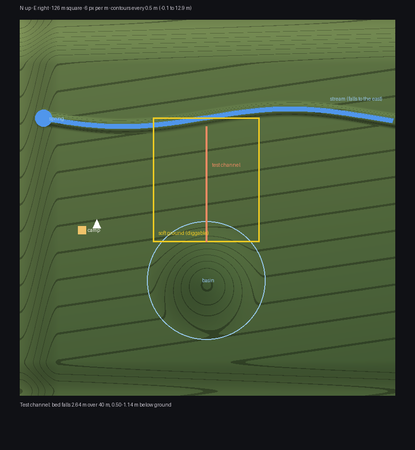

# MVP-1 brief — world-change proof, steps 1.1 to 1.3

*Claude Code, 2026-10-13. Plan: GDD 0.4 §14.4 (approved, D-20). This brief covers
the proof scene and the two spikes; steps 1.4–1.9 get their own sections when they
start. Evidence is added at the end as each step closes.*

## Goal

Prove the hardest technology before building anything on it: a channel cut into
diggable ground that water can run through, in a scene that looks like a stream
bank above a basin (GDD §14.5).

## Step 1.1 — Proof scene `L_WorldProof`

**Deliverable.** `/Game/Wildwright/WorldProof/L_WorldProof`, rebuilt by
`Tools/WorldProof/build_world_proof.py` (headless, idempotent, `WW_WORLDPROOF_FORCE=1`
rebuilds only actors tagged `WorldProof`) and checked by `verify_world_proof.py`.

**Terrain.** A Landscape created from code, 127 × 127 vertices at 1 m (126 m
square, 2 × 2 components of 63 quads), centred on the origin. +X is north, +Y is
east. Heights come from one Python function, so anything placed on the terrain uses
the same numbers.

| Feature | Where (metres) | Shape |
|---|---|---|
| General fall | Whole map | Down to the south and slightly to the east |
| Spring | (29.8, −55) | A pool about 1 m deep |
| Stream | Centre line x = 30 + 3·sin(y/18), from the spring to the east edge | Bed 0.9 m below the banks, 2.5 m across; bed falls about 0.9 m west to east |
| Bank | Between the stream (x ≈ 30) and the basin rim (x ≈ −5) | Falls about 2 m |
| Basin | Bowl centred at (−25, 0), radius 20 | Bottom about 4.7 m below the stream bed at y = 0 |
| Soft-ground zone | x −12 to 30, y −18 to 18 (42 m × 36 m), aligned to the 1 m grid | Includes the stream's south bank and the basin's north rim, so a channel can open into both |
| Camp | Around (−8, −42) | Fire ring, tent marker, player start facing the zone |
| Rims | North, south and west edges | Low hills so the scene reads as enclosed; the east edge is open where the stream leaves |

*Drawn from `proof_terrain.py` by `Tools/WorldProof/preview_terrain.py`. North up.*

**Placeholders in 1.1.** The stream's water is a chain of thin water-coloured slabs
at bed + 0.5 m (replaced by spike S-2). The soft zone is marked by corner posts and
a label (replaced by spike S-1). The ground material is a simple grass-to-soil blend
by slope; real vegetation comes with PCG in MVP-2.

**Code.**
- New editor-only module `WildwrightEditor` with
  `UWildwrightWorldBuildLibrary::CreateLandscapeFromHeights`, which follows the
  engine's own New Landscape tool (`ALandscapeProxy::Import`). Editor-only: it never
  ships in the game.
- `Tools/WorldProof/build_world_proof.py`, `verify_world_proof.py`, `README.md`.

**Accepted when.**
1. Both targets build; existing tests and the `L_TestRange` verifier still pass.
2. The generator reports `RESULT ok`; a forced rebuild gives the same terrain.
3. The verifier passes: one Landscape of 127 × 127 vertices; the stream bed lies
   below both banks along its length; the basin bottom is at least 3 m below the
   stream bed; a straight channel from the stream to the basin inside the soft zone
   can keep its bed 0.5–1.5 m below the ground and still fall all the way; the
   player start stands on the ground; Map Check reports no errors.
4. The owner walks from the camp to the stream and the basin and the layout reads.

## Step 1.2 — Spike S-1: diggable ground (decides OD-14)

**Question.** How does a channel get cut below the terrain surface, given that
Landscape cannot be edited at runtime in a shipped game?

**Candidates.**
- **B (try first): recessed Landscape.** Lower the Landscape inside the soft zone by
  about 3 m and cover the zone with a runtime terrain tile (Geometry Script dynamic
  mesh) whose surface matches the original heights, with a skirt at its border.
  Channels carve only the tile. No Landscape holes or visibility painting needed.
- **A: Landscape hole.** Paint the zone out of the Landscape with its visibility
  layer and fill the hole with the same tile.

**Measured.**
| Criterion | Pass |
|---|---|
| Seam | No visible seam or lighting break at the zone border at 5 m and 20 m (owner review) |
| Collision | Down-traces every 0.5 m along the border and across a test channel hit within 2 cm of the expected height; the player can walk into and out of a 1 m deep channel |
| Rebuild time | Re-carving a 20 m channel takes ≤ 50 ms on the game thread (GDD §15.1) |
| Memory | Tile mesh for the 42 m × 36 m zone at 0.5 m resolution ≤ 5 MB |
| Determinism | Rebuilding from base heights plus the earthwork list gives an identical mesh hash |

## Step 1.3 — Spike S-2: water in channels (decides OD-15)

**Question.** How is water drawn in a player-made channel, driven by flow numbers?

**Candidates.** A: a custom ribbon mesh along the channel with an animated water
material, width and level from flow. B: the Water plugin's river spline
(Experimental in 5.8), only if A looks poor.

| Criterion | Pass |
|---|---|
| Follows the bed | Water level sits at bed + depth(flow) along the whole channel; no floating or buried sections |
| Updates | A flow change is visible within 100 ms |
| Look | Reads as moving water at 5–20 m (owner review) |
| Cost | Recorded draw calls and game-thread time per 20 m of channel |

## Evidence

### Step 1.1 — built and verified 2026-10-13; owner walk-through pending

Logs in `D:\Wildwright\Saved\ClaudeScratch\` (ignored by Git).

| Check | Result |
|---|---|
| New editor module `WildwrightEditor` | Editor target `Result: Succeeded` (18.4 s); the game link contains no `WildwrightEditor` code |
| Generator | `[WWWorldProof] RESULT ok 75`: Landscape 127 × 127, 4 environment, 40 water, 8 zone posts, 10 camp, 12 sign actors; exit 0. A forced rebuild removed and recreated the same 75 |
| Verifier `verify_world_proof.py` | **10/10**: terrain matches `proof_terrain.py` at 361 vertices (worst 4 mm); stream bed ≥ 0.5 m below both banks from y −50 to 60; basin 4.73 m below the stream bed; a 40 m downhill test channel fits in the zone with its bed 0.50–1.14 m below ground; player start on the ground; markers and water present; Map Check 0 errors, 0 warnings |
| Regression | Automation 11/11 `Success`; `L_TestRange` verifier 16/16; game target `Result: Succeeded`; editor-only plugin check PASS |
| Found and fixed | The generator crashed in Python's own shutdown after saving (exit 3). Twelve bisection runs; fixed by dropping module-level Unreal references before quitting (engineering guide gotcha 26) |
| Not verified | How the scene looks and feels in the editor: owner walk-through (acceptance 4). Rendering is not checked headless |
